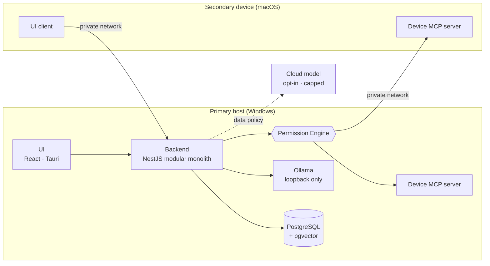
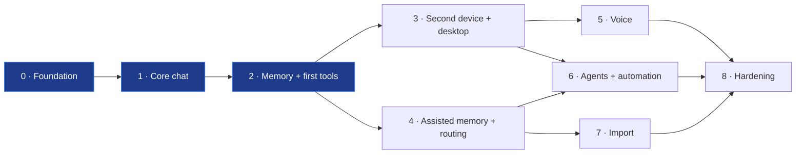

<p align="center">
  
</p>

<p align="center">
  
  
  
  
  
</p>

<p align="center">
  <a href="docs/PLAN.md"><b>Project plan</b></a> ·
  <a href="docs/PLAN.md#3-prior-art-and-lessons-learned">Prior art</a> ·
  <a href="docs/PLAN.md#6-architecture">Architecture</a> ·
  <a href="docs/PLAN.md#15-delivery-phases">Roadmap</a>
</p>

---

## Overview

**MELL** is a personal AI assistant platform designed to run primarily on the user's own hardware. It is not a chatbot with a microphone attached; it is built around three capabilities that existing assistants handle poorly:

| | Capability | What it means |
| --- | --- | --- |
| 🧠 | **Governed memory** | Every remembered fact has a source, a confirmation state, a validity window and a scope. Nothing is stored, changed or forgotten silently. The user can inspect, export and delete all of it. |
| 🛡️ | **Permission-gated actions** | The model only *proposes* actions on the user's machines. A deterministic policy engine outside the model decides, with full audit and explicit approval for anything destructive or external. |
| 🇹🇷 | **Turkish-first interaction** | Models, embeddings and voice components are selected by measurements on Turkish, not by English benchmarks. |

## Status

> [!NOTE]
> MELL is in the **planning phase**. There is no runnable code yet. The current deliverable is the [project plan](docs/PLAN.md), which defines scope, architecture, security model and delivery phases.

## Design Principles

- **Small, reliable core first.** Voice, multi-agent orchestration and proactive features come only after the core passes its evaluation gates.
- **Security is enforced in code, not in prompts.** Model output, web content, documents and tool results are treated as untrusted data.
- **Break the lethal trifecta.** A turn that has seen untrusted content cannot perform external or destructive actions.
- **Local by default.** Local models first; cloud models are opt-in, policy-filtered and spend-capped.
- **Measure, then decide.** Model, embedding and voice choices are made with versioned evaluation sets.

## Architecture



See [Section 6 of the plan](docs/PLAN.md#6-architecture) for trust boundaries, request flows and the full diagram set.

## Technology Stack

| Layer | Choice |
| --- | --- |
| Language | TypeScript (`strict`) end-to-end |
| Backend | Node.js LTS · NestJS (Fastify) · Zod |
| Data | PostgreSQL · pgvector · Drizzle ORM |
| AI | Vercel AI SDK behind internal ports · Ollama (local) · optional cloud provider |
| Tools | Model Context Protocol — official TypeScript SDK, first-party servers only |
| Frontend | React · Vite · shadcn/ui · TanStack Query |
| Desktop | Tauri 2 |
| Voice *(Phase 5)* | LiveKit Agents (Node.js), self-hosted |
| Quality | Vitest · Testcontainers · Playwright · dependency-cruiser · OpenTelemetry |

The rationale and the alternatives considered (Java/Spring, Python) are in [Section 6.7](docs/PLAN.md#67-language-and-framework-selection).

## Roadmap



Phases 0–2 form **v0.1**: local streaming chat, explicit memory with a Memory Center, and read-only device tools behind the permission engine. Each phase has explicit exit criteria in the [plan](docs/PLAN.md#15-delivery-phases).

## Documentation

| Document | Contents |
| --- | --- |
| [`docs/PLAN.md`](docs/PLAN.md) | Scope, prior-art review, architecture, model strategy, permission model, memory design, voice, security, data model, evaluation, phases, risks |
| `docs/adr/` *(planned)* | Architecture Decision Records |
| `docs/benchmarks/` *(planned)* | Measured model, embedding and latency results |

## Planned Repository Layout

```text
mell-assistant/
├── apps/
│   ├── backend/        NestJS modular monolith
│   ├── ui/             React + Vite (Tauri shell from Phase 3)
│   └── mcp-device/     First-party device MCP server
├── packages/
│   └── contracts/      Shared Zod schemas and types
├── infrastructure/     Docker Compose for PostgreSQL, Ollama and services
├── eval/               Memory, model, tool-call and security evaluation sets
└── docs/               Plan, ADRs, benchmarks
```

## Run

Not runnable yet. Commands for local start, tests and required environment variables are added here in Phase 0 ([plan](docs/PLAN.md#phase-0--foundation)).

## Owner

Eren ([@eerenyilmazz](https://github.com/eerenyilmazz))

## Playbook

This project follows [agent-playbook](https://github.com/eerenyilmazz/agent-playbook). Agents and contributors load its rules as described in [`AGENTS.md`](AGENTS.md).

- Templates: software, desktop, web
- Roles: backend, frontend, qa-security, security-reviewer, code-reviewer, decision-maker, technical-writer, devops-cloud
- Stack: TypeScript (strict) on Node.js LTS · NestJS · Drizzle · PostgreSQL + pgvector · Vercel AI SDK · MCP TypeScript SDK · React or Angular (OD-5) · Tauri 2

### Overrides

Only values that differ from the playbook defaults.

| Rule | Default | This project | Reason |
| --- | --- | --- | --- |
| API p95 read latency | 300 ms | 300 ms, but chat is measured as time-to-first-token (baseline set in Phase 1) | Streaming responses; total duration depends on answer length |
| API p95 write latency | 800 ms | 800 ms, excluding model calls | Model latency is tracked separately per model |
| Browser matrix | latest 2 majors | WebView2 (Windows) and WKWebView (macOS) via Tauri; latest Chrome for development | Desktop shell, single user |
| Sprint length | 1–2 weeks | No sprints; phase-based delivery with exit criteria | Single developer, part-time |
| Release watch window | 60 min | Not applicable until a packaged release exists | No production deployment |
| Severity response times | Sev1 now / Sev2 1 h / Sev3 next day | Best effort | Personal project |

### Out of scope

See [Non-Goals](docs/PLAN.md#42-non-goals-v01): microservices, model training, third-party plugins or MCP servers, messaging-channel integrations, unattended destructive or external actions.

## Contributing

Pull requests only; `main` is protected. Read [`CONTRIBUTING.md`](CONTRIBUTING.md). Decisions are recorded in [`docs/adr/`](docs/adr/). Report vulnerabilities as described in [`SECURITY.md`](SECURITY.md).

## Security

MELL is designed to hold personal data and act on the user's machines, so its security model is part of the core design rather than an add-on. The threat model, the trifecta rule, MCP tool-definition pinning, network binding rules and supply-chain controls are described in the plan ([Sections 9](docs/PLAN.md#9-tools-and-permission-model), [12](docs/PLAN.md#12-security-and-privacy) and [6.8](docs/PLAN.md#68-supply-chain-controls)).

## License

Not licensed yet. Until a license is added, all rights are reserved by the author.
