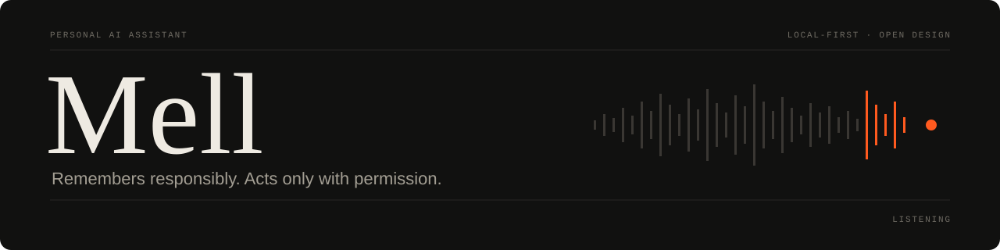
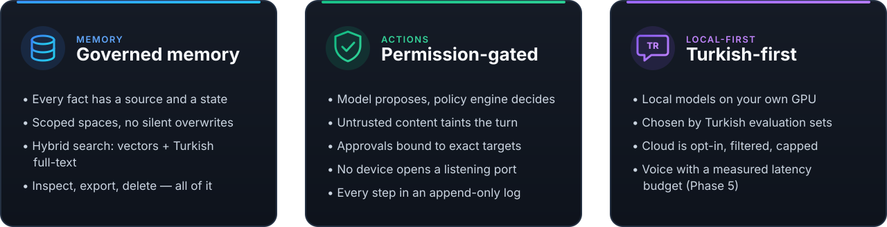
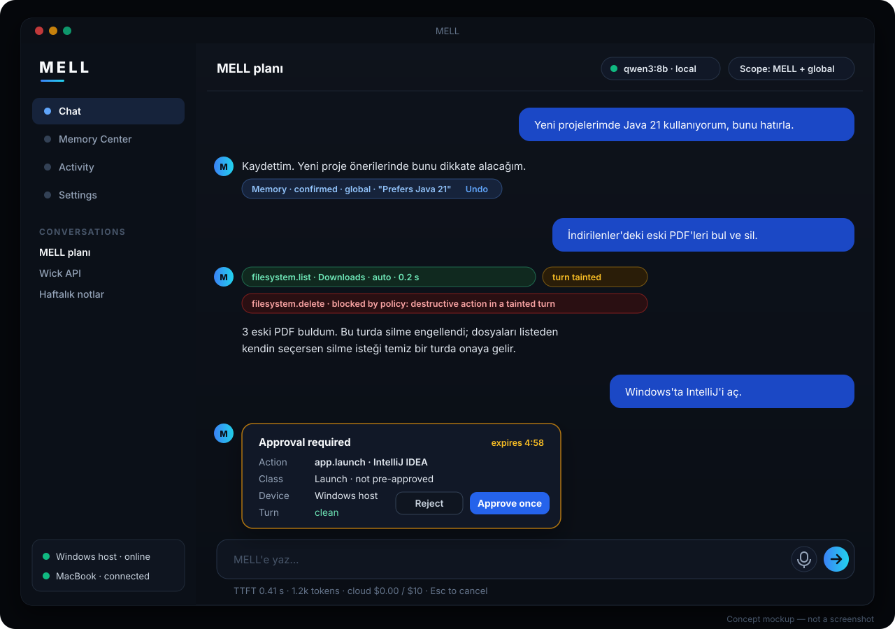
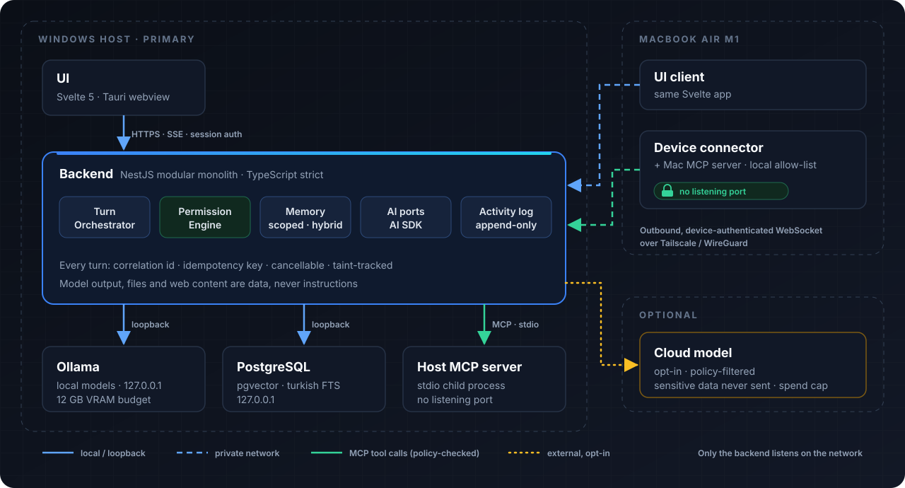
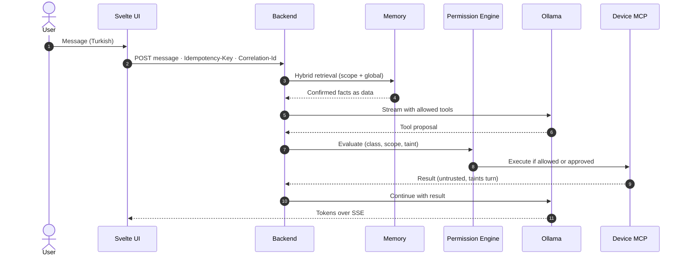
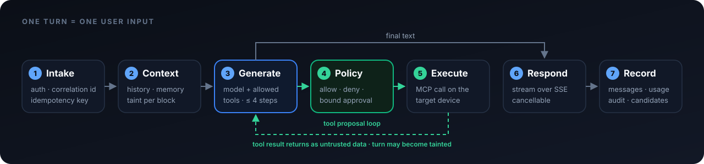
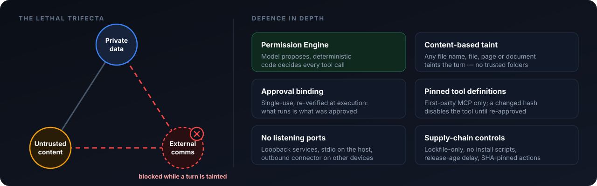
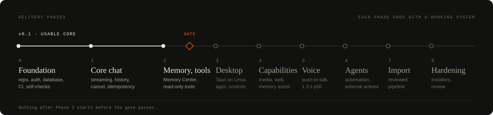

  

  
  
  
  

  
  
  
  
  
  
  

<h3 align="center">A local-first personal AI assistant that remembers responsibly and acts on your computers only with permission.</h3>

  <a href="#why-mell">Why MELL</a> ·
  <a href="#architecture">Architecture</a> ·
  <a href="#how-a-turn-works">How a turn works</a> ·
  <a href="#security-model">Security</a> ·
  <a href="#roadmap">Roadmap</a> ·
  <a href="docs/PLAN.md"><b>Full plan</b></a>

---

> [!NOTE]
> **MELL is in the planning phase.** There is no runnable code yet. The design, decisions and threat model are complete enough to start Phase 0; see the [project plan](docs/PLAN.md).

## Why MELL

Most assistants either forget everything or remember things you never asked them to, and agents that can touch your files tend to trust whatever text they read. MELL is designed around the opposite defaults.

  

  
   
  <i>Concept of the command surface — what you asked, what Mell did, and the one decision it needs from you.</i>

## Ask for anything

Mell is not limited to chat. Abilities arrive as capability packs, so the list keeps growing without changing the core:

| You say | Mell does | Policy |
| --- | --- | --- |
| "Spotify'dan biraz lo-fi aç" | Starts playback through the media pack | Control — automatic once you allow the pack |
| "Şu YouTube videosunu aç" | Opens the link in your browser | Launch |
| "IntelliJ'de MELL projesini aç" | Launches the IDE with the project on your Windows host | Launch |
| "Sesi yarıya indir" | Sets system volume | Control |
| "İndirilenler'deki eski PDF'leri sil" | Lists files, then stops: deleting after reading untrusted file names needs a clean, approved turn | Destructive |

Catalog, rules and phases: [plan, Section 9.8](docs/PLAN.md#98-capabilities--ask-for-anything).

## Architecture

  

| Principle | In practice |
| --- | --- |
| **One host, one source of truth** | The backend on the Windows host holds all state, credentials and policy. |
| **Nothing listens that doesn't have to** | Ollama and PostgreSQL bind to loopback; device MCP servers open no port at all. |
| **Modular monolith** | NestJS modules with enforced boundaries — no microservices to operate. |
| **Replaceable models** | All model access goes through internal ports; local by default, cloud opt-in. |

<b>Request flow (sequence diagram)</b>

## How a turn works

Every message goes through the same seven deterministic stages. The model decides *what to say*; code decides *what is allowed to happen*.

  

## Security model

MELL holds personal data and can act on your machines, so security is part of the core design. The key idea: an agent with private data, untrusted content and a way to send data out can be turned against its user — so MELL removes the third capability whenever untrusted content is in play.

  

Threats, mitigations and the tests that verify them: [threat model](docs/security/threat-model.md) (STRIDE per boundary, OWASP Top 10 for Agentic Applications 2026 mapping, abuse cases).

## Technology stack

| Layer | Choice | Why |
| --- | --- | --- |
| Language | TypeScript (`strict`), end-to-end | One language for backend, UI, MCP servers and desktop shell ([ADR 0001](docs/adr/0001-typescript-end-to-end-nestjs-monolith.md)) |
| Backend | Node.js LTS · NestJS · Zod | Modules, DI and guards that mirror the layered design |
| Data | PostgreSQL · pgvector · Drizzle | Facts, vectors and Turkish full-text in one store ([ADR 0002](docs/adr/0002-postgresql-pgvector-single-store.md)) |
| AI | Vercel AI SDK behind internal ports · Ollama | Provider-agnostic; local models first ([ADR 0006](docs/adr/0006-manual-model-selection-first.md)) |
| Tools | Model Context Protocol, official TypeScript SDK | First-party servers with pinned definitions ([ADR 0003](docs/adr/0003-first-party-mcp-servers.md)) |
| UI | Svelte 5 · SvelteKit (static) · shadcn-svelte · Tailwind | Fine-grained updates for token streaming ([ADR 0011](docs/adr/0011-svelte-5-frontend.md)) |
| Desktop | Tauri 2 | Small footprint on Windows and macOS |
| Voice *(Phase 5)* | LiveKit Agents (Node.js), self-hosted | Same language, measured latency budget |
| Quality | Vitest · Testcontainers · Playwright · dependency-cruiser · OpenTelemetry | Tests, architecture rules and per-stage traces |

## Roadmap

  

<b>What v0.1 includes</b>

- Local Turkish chat with streaming, history, cancellation and idempotent requests
- Explicit, scoped memory with a Memory Center (view, edit, export, delete)
- Manual model selection; one resident local model plus embeddings
- Read-only device tools (`filesystem.list`, `filesystem.read`, `system.status`) behind the Permission Engine
- Activity log of every tool call, approval and memory change

Exit criteria for each phase: [plan, Section 15](docs/PLAN.md#15-delivery-phases).

## Documentation

| | Document | What you'll find |
| --- | --- | --- |
| 📘 | [Project plan](docs/PLAN.md) | Scope, prior-art review, architecture, permission model, memory, voice, data model, evaluation, phases, risks |
| 🧭 | [Decision records](docs/adr/) | Twelve ADRs with options, risks and rollback |
| 🛡️ | [Threat model](docs/security/threat-model.md) | Assets, adversaries, STRIDE, OWASP Agentic Top 10, security tests |
| 📖 | [Glossary](docs/GLOSSARY.md) | Taint, approval binding, turn pipeline and other terms |
| 🗂️ | [Documentation index](docs/README.md) | Everything else, organised by what you need |

## Run

Not runnable yet. Commands for local start, tests and required environment variables are added here in Phase 0 ([plan](docs/PLAN.md#phase-0--foundation)).

## Owner

Eren ([@eerenyilmazz](https://github.com/eerenyilmazz))

## Playbook

This project follows [agent-playbook](https://github.com/eerenyilmazz/agent-playbook). Agents and contributors load its rules as described in [`AGENTS.md`](AGENTS.md).

- Templates: software, desktop, web
- Roles: backend, frontend, qa-security, security-reviewer, code-reviewer, decision-maker, technical-writer, devops-cloud
- Stack: TypeScript (strict) on Node.js LTS · NestJS · Drizzle · PostgreSQL + pgvector · Vercel AI SDK · MCP TypeScript SDK · Svelte 5 · Tauri 2

### Overrides

Only values that differ from the playbook defaults.

| Rule | Default | This project | Reason |
| --- | --- | --- | --- |
| API p95 read latency | 300 ms | 300 ms, but chat is measured as time-to-first-token (baseline set in Phase 1) | Streaming responses; total duration depends on answer length |
| API p95 write latency | 800 ms | 800 ms, excluding model calls | Model latency is tracked separately per model |
| Browser matrix | latest 2 majors | WebView2 (Windows) and WKWebView (macOS) via Tauri; latest Chrome for development | Desktop shell, single user |
| Sprint length | 1–2 weeks | No sprints; phase-based delivery with exit criteria | Single developer, part-time |
| Release watch window | 60 min | Not applicable until a packaged release exists | No production deployment |
| Severity response times | Sev1 now / Sev2 1 h / Sev3 next day | Best effort | Personal project |

### Out of scope

See [Non-Goals](docs/PLAN.md#42-non-goals-v01): microservices, model training, third-party plugins or MCP servers, messaging-channel integrations, unattended destructive or external actions.

## Contributing

Pull requests only; `main` is protected. Read [`CONTRIBUTING.md`](CONTRIBUTING.md). Decisions are recorded in [`docs/adr/`](docs/adr/). Report vulnerabilities as described in [`SECURITY.md`](SECURITY.md).

## License

Not licensed yet. Until a license is added, all rights are reserved by the author.

---

  Designed in the open · documentation-first · every decision recorded

