# MELL — Project Plan

| Field         | Value                                                |
| ------------- | ---------------------------------------------------- |
| Status        | Draft v0.5.3 — for review                            |
| Owner         | Eren                                                 |
| Last updated  | 2026-11-26                                           |
| Document type | Plan (no implementation in this phase)               |
| Changes v0.5.3 | UI design direction changed from a chat layout to a voice-first command center (16, 16.6) |
| Changes v0.5.2 | Frontend decided: Svelte 5 (OD-5 closed, ADR 0011); streaming-rendering rules for the chat UI (16.0) |
| Changes v0.5.1 | Read-tool size and count limits (9.7); threat model linked from Section 12. See `CHANGELOG.md` for earlier versions |
| Changes v0.5  | Fixes from external review of v0.4: device connectivity without listening ports (6.3), turn pipeline and cross-cutting concerns (6.5, 6.9), content-based taint (9.3), approval binding against TOCTOU (9.4), hybrid memory retrieval (10.9), consistent voice budget (11.2), data model aligned with ER diagram (13.1); project now follows `agent-playbook` (19) |

---

## 1. Purpose

This document defines the scope, architecture, delivery phases and engineering rules for **MELL**, a personal AI assistant platform. It is the single reference for what will be built, in what order, what is explicitly out of scope, and why.

MELL is not intended to be a voice-enabled chatbot. The long-term goal is a personal assistant that:

- maintains a persistent, user-controlled memory with provenance;
- selects among local and cloud language models per task;
- performs actions on the user's computers through a permission-gated tool layer;
- adapts to confirmed user preferences over time.

The guiding principle is **a small, reliable, secure core first**. Voice, multi-agent orchestration and proactive features are added incrementally on top of it, and only after the core has passed its evaluation gates.

## 2. Positioning

Mature open-source chat front ends for local models already exist (see Section 3.1). Re-implementing a general chat UI is therefore not where MELL adds value. MELL's differentiators are:

1. **Governed memory** — every fact has a source, a confirmation state, a validity window and a scope; the user can inspect, export and delete all of it.
2. **Permissioned device actions** — actions on the user's machines are decided by a deterministic policy engine outside the model, with full audit.
3. **Turkish-first interaction** — model, embedding and voice choices are evaluated on Turkish, not assumed from English benchmarks.

Work that does not serve one of these three is a candidate for reuse rather than custom implementation.

## 3. Prior Art and Lessons Learned

Before fixing the architecture, comparable projects and their documented failures were reviewed. Each lesson below maps to a concrete decision in this plan.

### 3.1 Summary

| Project / source | What it is | Lesson | Decision in this plan |
| --- | --- | --- | --- |
| OpenClaw (formerly Clawdbot / Moltbot) | Self-hosted, always-on personal assistant with persistent memory, shell access and a third-party skill marketplace | Security researchers documented malicious marketplace skills performing data exfiltration and prompt injection, internet-exposed instances, poor secret handling, a flaw letting malicious websites hijack the local agent, and unexpectedly high model bills. Persistent memory combined with autonomy was singled out as an amplifier of risk. | No third-party skills/servers in v0.x (Sec. 9.6); localhost backend requires authentication and origin checks (Sec. 12); spend cap (Sec. 12); memory treated as a security boundary (Sec. 10.6) |
| Simon Willison, "lethal trifecta" | Threat model for agents | An agent that combines access to private data, exposure to untrusted content and the ability to communicate externally can be made to exfiltrate data by prompt injection; the reliable mitigation is to remove one of the three legs, not to rely on guardrails. | Trifecta rule enforced by the permission engine (Sec. 9.3); no external-communication tools before Phase 6 |
| MCP security research (2025–2026) | Academic and vendor analyses of MCP clients and servers | Tool poisoning — malicious instructions hidden in tool metadata — was found to be the most prevalent client-side MCP vulnerability; most tested clients validated tool definitions insufficiently. Tool definitions can also change after approval ("rug pull"). | First-party MCP servers only; tool definitions pinned by hash and re-approved on change; full tool descriptions visible in UI (Sec. 9.6) |
| Exposed Ollama instances | Internet-wide scans (Cisco Talos, SentinelLABS/Censys, Rapid7) | Ollama binds to localhost by default, yet scans in 2025–2026 found from ~1,100 up to ~175,000 reachable hosts, many of them abused by third parties. Exposure typically comes from a single bind-address change. | Ollama never bound to a non-loopback interface; cross-device access only via backend over private network; startup self-check (Sec. 12) |
| Qwen3 + Ollama tool calling | Bug reports across CrewAI, Strix, n8n, Home Assistant, Ollama issues | Tool calling with Qwen-family models through Ollama is usable but inconsistent: tool calls returned as plain text, template/parser mismatches, second tool in a chain not executed. Some users resolved issues by switching runtime. | Tool-call contract tests; strict parsing with rejection; pinned Ollama version; runtime behind a port so llama.cpp can replace Ollama (Sec. 7.4) |
| Ollama model scheduling | Ollama docs and community guides | Switching models evicts the previous one depending on `OLLAMA_MAX_LOADED_MODELS`; default keep-alive is 5 minutes; cold loads dominate latency. | One resident chat model plus one embedding model; explicit keep-alive configuration (Sec. 7.3) |
| ChatGPT memory | Large consumer memory feature | Users reported silently lost memories, entries changed or replaced without notice, no capacity warning, and context from separate areas of life spilling together. | Memory export and backup; no silent overwrite; visible capacity; scoped memory spaces (Sec. 10) |
| Mem0, Letta (MemGPT) | Agent-memory frameworks | Two distinct shapes: an extraction-based memory layer called from any agent (Mem0) versus a full agent runtime where memory is the core abstraction (Letta). Public benchmark claims between vendors are disputed. | Own memory module following the extraction-layer shape; no runtime lock-in; judge with our own Turkish evaluation set, not vendor benchmarks (Sec. 10, 14) |
| Mycroft AI → OpenVoiceOS | Open-source voice assistant company, shut down in 2023 | Ran out of funds and was damaged by patent litigation; the community fork survived. Building a full voice stack is expensive even for a funded team. | Voice assembled from existing components; no custom hardware; deferred to Phase 5 (Sec. 11) |
| openWakeWord, Home Assistant, Porcupine | Wake-word engines | openWakeWord's standard training pipeline is English-oriented; non-English wake words require extra effort and still produce false activations. Turkish is not among Porcupine's published languages. | Push-to-talk / hotkey first; Turkish wake word is a separate, late, measured experiment (Sec. 11) |
| Voice agent latency guides (Twilio, ElevenLabs, NVIDIA) | Production voice-agent benchmarks | Sub-second end-to-end latency is the common target; the budget is dominated by end-of-utterance detection and LLM time-to-first-token. | Explicit latency budget and per-stage tracing in Phase 5 (Sec. 11.2) |
| Open WebUI, LibreChat | Self-hosted chat front ends | Both are mature, actively maintained, work with Ollama and support tools/MCP. | Chat UI kept minimal; MELL does not compete on chat UX (Sec. 2) |
| Turkish embedding research (TR-MTEB, TurkColBERT, TurkEmbed) | Turkish retrieval benchmarks and models | Turkish-specific and Turkish-adapted encoders exist and are benchmarked separately from English-centric models. | Embedding chosen by a Turkish recall test across several candidates (Sec. 7.2, 14.3) |
| npm / PyPI supply-chain worms (Shai-Hulud family, 2025–2026) | Self-propagating malware in package registries | Repeated waves compromised hundreds of npm packages at a time, including through hijacked CI release pipelines; one campaign also reached PyPI. The worm's source was published, lowering the bar for copycats. | Small dependency set, lockfile-only installs, lifecycle scripts disabled, minimum release age, CI-only publishing (Sec. 6.8) |
| MCP SDK tiers (2026) | Official SDK support levels | TypeScript and Python SDKs are Tier 1 and track the current spec (2026-07-28); the Java SDK is not in the Tier 1 set. | MCP built on the TypeScript SDK (Sec. 6.7) |

### 3.2 Cross-Cutting Conclusions

1. **Security failures in personal assistants come from defaults and extensibility, not from exotic attacks.** Exposed ports, unauthenticated local endpoints, third-party skills and broad tool access are the recurring causes.
2. **Memory is both the main value and the main liability.** Silent loss, silent modification and over-eager extraction erode trust faster than missing features.
3. **Local small models are good enough for chat but unreliable for multi-step tool use.** The plan must tolerate malformed tool calls rather than assume correctness.
4. **Voice is where solo and funded projects alike overrun.** It must not block the core.

## 4. Goals and Non-Goals

### 4.1 Goals (v0.1)

1. Text chat with streaming responses through a local model.
2. Persistent conversation history.
3. Explicit memory: the user can instruct MELL to remember, recall, edit, export and delete facts.
4. A provider abstraction supporting at least one local and one cloud model.
5. Manual model selection per conversation.
6. Read-only tools exposed through a first-party MCP server, gated by the permission engine.
7. Audit logging of every tool invocation and every memory change.

### 4.2 Non-Goals (v0.1)

| Item                                          | Decision                                           |
| --------------------------------------------- | -------------------------------------------------- |
| Microservices, Kubernetes                     | Not planned                                        |
| Training or fine-tuning a base model          | Not planned                                        |
| Running 30B+ models locally                   | Out of scope for current hardware                  |
| Third-party skills, plugins or MCP servers    | Not before an explicit security review (Phase 8)   |
| Messaging-channel integrations (WhatsApp etc.)| Not planned for v0.x                               |
| External-communication tools (email, upload)  | Not before Phase 6                                 |
| Real-time voice, wake word                    | Deferred (Phase 5)                                 |
| Multi-agent orchestration                     | Deferred (Phase 6)                                 |
| Automatic memory extraction                   | Deferred (Phase 4); explicit memory only           |
| Desktop packaging (Tauri)                     | Deferred (Phase 3); browser UI on localhost        |
| Redis                                         | Deferred until a documented need exists            |
| VPS / remote hosting                          | Decided by Open Decision OD-1                      |
| Mobile client                                 | After desktop is stable                            |
| Unattended destructive or external actions    | Never                                              |

## 5. Constraints and Assumptions

| ID  | Constraint / Assumption |
| --- | --- |
| C-1 | Single developer working part-time alongside full-time employment and other projects. |
| C-2 | Primary host: Windows desktop with an RTX 4070 Ti (12 GB VRAM). |
| C-3 | Secondary client: MacBook Air M1. |
| C-4 | The Windows host is not guaranteed to be online at all times; the Mac client depends on it. |
| C-5 | Primary interaction language is Turkish; code, documentation and commits are in English. |
| C-6 | Single user initially; the schema is keyed by `user_id` so additional profiles can be added without rework. |

Constraint C-1 is the dominant risk. Scope decisions favour finishing a narrow, working release over a broad, partial one.

## 6. Architecture

### 6.1 Style

A **TypeScript modular monolith** (NestJS on Node.js LTS). Modules are separated by NestJS modules and enforced import rules, not by process boundaries. Extraction into separate services is not planned and will be considered only with a measured reason.

### 6.2 Deployment Topology

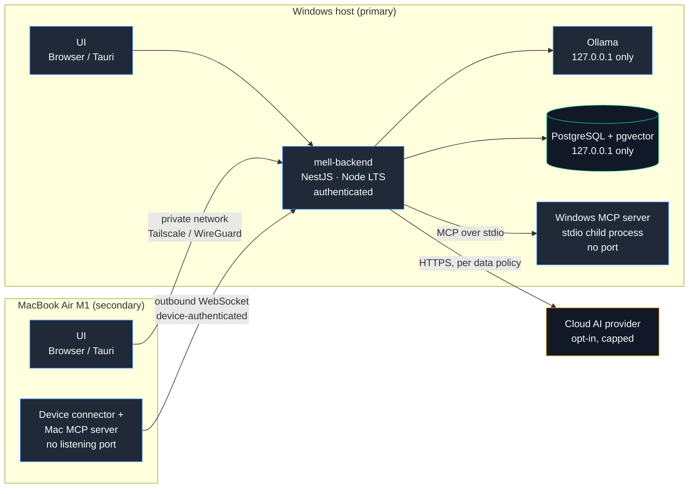

Key points:

- The backend is the only component that holds state, credentials and policy.
- The UI never accesses the database, the model runtime or the operating system directly.
- Only the backend listens on the private network; Ollama, PostgreSQL and every device MCP server are never reachable from another machine.
- Each machine exposes its capabilities through its own first-party MCP server. A command such as "open IntelliJ on my Windows machine" issued from the Mac is routed by the backend to the Windows MCP server. How each server is reached is defined in Section 6.3.

### 6.3 Device Integration and Connectivity

The original plan included a custom `mell-device-agent` protocol per OS. This plan replaces it with **one first-party MCP server per device**, using the official Tier 1 TypeScript MCP SDK for both client and servers. MCP-specific risks (Section 3.1) are addressed by first-party-only servers and pinned tool definitions (Section 9.6).

**No device MCP server opens a listening port.** v0.4 required MCP servers to bind to loopback while also expecting the Windows backend to reach the Mac server over the network — a contradiction. v0.5 resolves it by making every connection originate from the side that already has a trust anchor:

| Device | Transport | Who connects | Listening ports on the device |
| --- | --- | --- | --- |
| Windows host | MCP over **stdio**: the backend spawns the server as a child process | Backend → child process | None |
| Mac (and any later device) | MCP JSON-RPC carried over an **outbound, authenticated WebSocket** opened by the *device connector* on the Mac to the backend's private-network address | Device → backend | None |

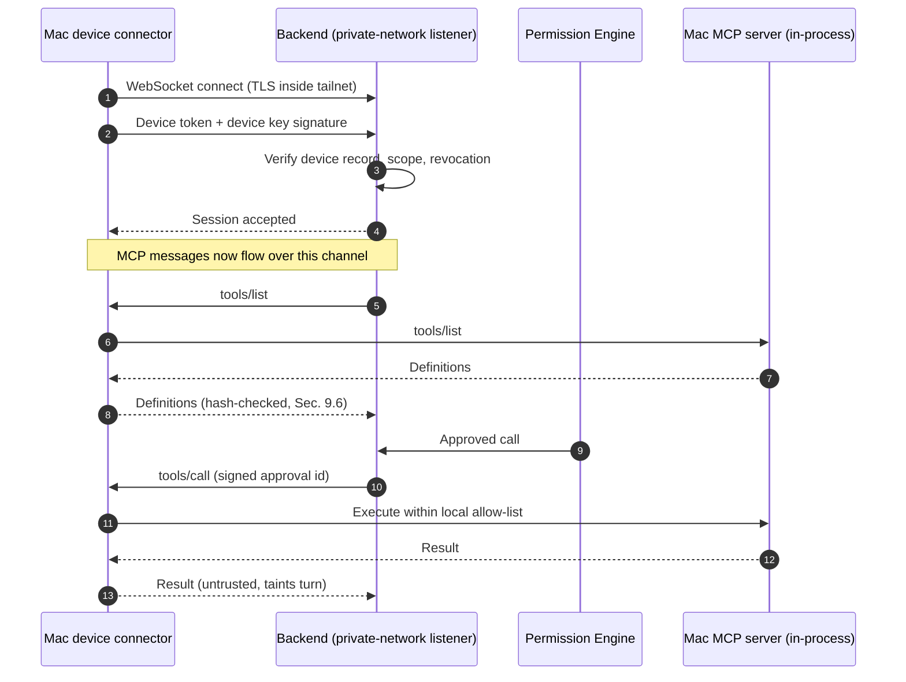

Properties:

- The Mac never accepts inbound connections, so it works behind NAT and has no port to scan or hijack.
- Device credentials are per device, revocable from the UI, and rotated on re-pairing.
- The connector enforces its own local allow-list (directories, applications) in addition to the backend policy, so a compromised backend cannot exceed what the user configured on that device.
- If the backend is offline the connector retries with backoff; the Mac UI shows the host as offline (Section 6.9).
- The connector may later be hosted inside the Tauri application to avoid a second process (OD-3).

Alternative considered: binding the Mac MCP server to the tailnet interface with mutual TLS. Rejected for v0.x because it adds a listening service on the laptop and a second certificate lifecycle. Recorded in ADR 0009.

### 6.4 Trust Boundaries

Everything outside the backend's policy layer is treated as untrusted, including the model itself.

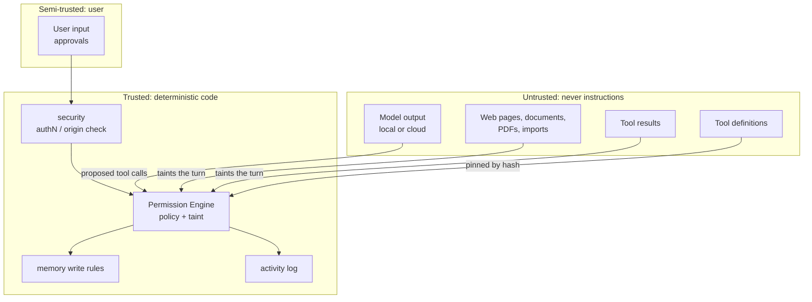

### 6.5 Turn Pipeline

A *turn* is one user input and everything MELL does in response. Every turn passes through the same fixed stages, owned by a `TurnOrchestrator` in the `conversation` module. This is MELL's "cognitive layer" in its v0.1 form: explicit, deterministic stages around the model, not a separate planner or agent system.

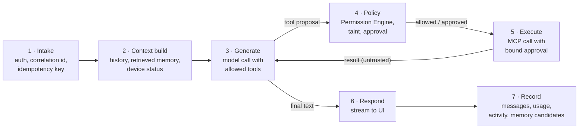

| Stage | Responsibility | v0.1 scope | Later |
| --- | --- | --- | --- |
| 1 Intake | Authenticate, assign correlation id, check idempotency key, open turn record | Yes | — |
| 2 Context build | Select history window, run memory retrieval (10.9), attach device status, mark taint of every included block | Yes | Summarised long history |
| 3 Generate | Call the selected model with a small, policy-filtered tool list; bounded tool-loop (max steps per turn) | Yes, max 4 tool steps | Rule-based routing (7.5) |
| 4 Policy | Classify each proposed call; allow, deny or create a bound approval (9.4) | Yes | — |
| 5 Execute | Run the call on the target device; feed the result back as untrusted data | Yes | Long-running tasks (Phase 6) |
| 6 Respond | Stream tokens and tool events over SSE | Yes | Voice output (Phase 5) |
| 7 Record | Persist messages, usage, activity; propose memory candidates (Phase 4) | Yes | Candidate extraction |

Intent classification and multi-step planning are **not** separate stages in v0.1; the model does both within stage 3 under the policy of stage 4. A dedicated planner is reconsidered in Phase 6 only if single-model turns prove insufficient on the evaluation set.

### 6.5.1 Chat Request Flow (v0.1)

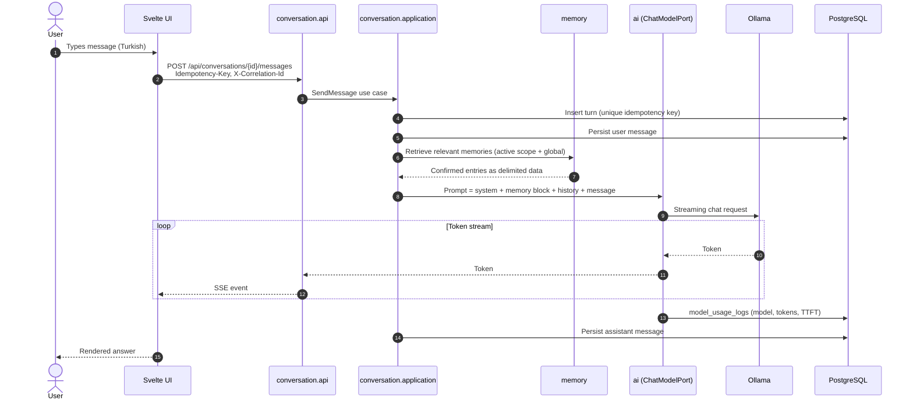

### 6.6 Technology Stack

| Layer | Choice | Introduced | Why |
| --- | --- | --- | --- |
| Language | TypeScript (`strict`) everywhere | Phase 0 | One language for backend, UI, MCP servers and desktop shell; shared schemas |
| Runtime | Node.js (active LTS) | Phase 0 | Conservative, best-supported runtime for the libraries below |
| Package manager | pnpm workspaces | Phase 0 | Strict dependency isolation; supply-chain settings (Sec. 6.8) |
| Backend framework | NestJS (Fastify adapter) | Phase 0 | Modules, DI, guards, interceptors — maps directly onto the layered design and on Spring concepts the developer already knows |
| Validation / contracts | Zod | Phase 0 | Single schema for API DTOs, tool schemas and model structured output |
| Database | PostgreSQL + pgvector | Phase 0 | Relational data and vectors in one store |
| ORM / migrations | Drizzle ORM + drizzle-kit | Phase 0 | SQL-first, typed, native pgvector column support, plain SQL migrations reviewable in PRs |
| AI integration | Vercel AI SDK (v7) behind internal ports | Phase 1 | Provider-agnostic streaming, tool calling, structured output, MCP client, tool-approval hooks |
| Local inference | Ollama via `ai-sdk-ollama` provider | Phase 1 | Keep-alive control and tool-call handling; replaceable by OpenAI-compatible endpoint or llama.cpp server |
| Embeddings fallback | Hugging Face Text Embeddings Inference (container) | Phase 2 | Serves Turkish-specific encoders not available in Ollama |
| MCP | Official TypeScript MCP SDK v2 (spec 2026-07-28) | Phase 2 | Tier 1 SDK; used for both client (backend) and device servers |
| Frontend | Svelte 5 (runes) + SvelteKit with the static adapter (SPA) + Vite | Phase 1 | Fine-grained reactivity and the smallest runtime among the candidates; official `@ai-sdk/svelte`; fits the Tauri webview (6.7.1, ADR 0011) |
| UI components | shadcn-svelte (copied source) + Tailwind CSS | Phase 1 | Components live in the repo, not as runtime dependencies |
| Client state | Svelte runes and a small typed API client generated from `packages/contracts` | Phase 1 | No global store or query library until a second use appears |
| Streaming Markdown | Block-level incremental renderer + DOMPurify | Phase 1 | Rendering cost per token stays constant (16.0) |
| Desktop shell | Tauri 2 | Phase 3 | Small footprint; backend bundled as a compiled Node sidecar on the host |
| Voice | LiveKit Agents (Node.js) + self-hosted LiveKit server | Phase 5 | Same language; WebRTC transport included; measured against alternatives |
| Testing | Vitest, Testcontainers (Node), Playwright | Phase 0–1 | Unit, integration with real PostgreSQL, end-to-end UI |
| Architecture rules | dependency-cruiser | Phase 0 | Enforces module boundaries in CI |
| Logging / tracing | pino + OpenTelemetry | Phase 0 | Structured logs; per-stage traces for chat and voice |
| Networking | Tailscale or WireGuard | Phase 3 | Private cross-device access |

Agent frameworks (Mastra, LangGraph.js) are deliberately **not** adopted in v0.x: the permission engine must own tool execution, and the AI SDK's lower-level loop keeps that boundary explicit. Re-evaluated in Phase 6.

### 6.7 Language and Framework Selection

Three stacks were compared for this project and this developer.

| Criterion | A. Java 21 + Spring Boot + Spring AI | B. TypeScript end-to-end (chosen) | C. Python + FastAPI |
| --- | --- | --- | --- |
| Developer expertise | Strongest (daily work) | Strong (frontend, MCP work) | Moderate |
| Languages in repo | Java + TypeScript (UI) + Rust (Tauri) | TypeScript (+ minimal Rust for Tauri) | Python + TypeScript (UI) + Rust |
| LLM toolkit maturity | Good (Spring AI 2.x) | Very good (AI SDK 7) | Very good (many options) |
| MCP SDK | Official, not Tier 1 | Tier 1, current spec | Tier 1, current spec |
| Voice frameworks | None native | LiveKit Agents (Node) | Pipecat, LiveKit Agents |
| Local ML (embeddings, STT) in-process | Weak | Weak (use containers / services) | Strongest |
| Shared types UI ↔ backend | Generated | Native (Zod schemas) | Generated |
| Supply-chain exposure | Lower (no install scripts in Maven) | Highest (npm worms 2025–2026) | Medium (PyPI also targeted) |
| Desktop packaging with Tauri | JVM sidecar, heavy | Compiled Node sidecar | Frozen Python sidecar |

**Decision: B.** The deciding factors are one language across every component, a Tier 1 MCP SDK on the current spec, the most mature provider-agnostic LLM toolkit, and a voice path that does not require a second language. ML-heavy pieces that are weak in TypeScript (Turkish embeddings, STT) are consumed as prebuilt services, not written in-process.

#### 6.7.1 Frontend framework

The owner set no language preference; the choice is made on performance and fit. The chat UI is dominated by one workload — appending streamed tokens to a growing message list — inside a desktop webview.

| Criterion | React 19 | Angular 20 | Svelte 5 (chosen) | SolidJS |
| --- | --- | --- | --- | --- |
| Update model | Component re-render + VDOM diff (compiler-memoised) | Signals (zoneless) | Compiled fine-grained updates (runes) | Runtime signals |
| js-framework-benchmark position | Behind signal-based frameworks | Middle | Top tier, close to vanilla JS | Top tier, close to vanilla JS |
| Runtime size | Largest of the four | Large | Smallest | Very small |
| Official AI SDK UI package | Yes (most complete) | Yes | Yes | Community only |
| Ecosystem for chat UIs | Largest | Medium | Medium | Small |
| Tauri fit | Good | Good | Very good (common Tauri template) | Good |

Svelte 5 combines top-tier rendering performance and the smallest runtime with an official AI SDK package; SolidJS is comparable on speed but lacks official AI SDK support. React's larger ecosystem does not outweigh its per-token re-render model for this workload. Benchmarks are re-checked against the live js-framework-benchmark results before Phase 1; the framework is behind the same REST/SSE contract, so the UI can be replaced without backend changes.

**Accepted costs:** the highest supply-chain exposure of the three (mitigated by Section 6.8), and less backend experience in Node than in Java (mitigated by NestJS, whose module/DI/guard model mirrors Spring). If either cost proves too high in Phase 0–1, option A remains viable because all AI and storage access is behind ports. Recorded as ADR 0001.

### 6.8 Supply-Chain Controls

Because MELL will hold personal data and run tools on the user's machines, a compromised dependency is a critical-severity event.

1. **Lockfile-only installs** (`pnpm install --frozen-lockfile`) locally and in CI.
2. **Dependency lifecycle scripts disabled**; any package that needs a build script is allow-listed explicitly with a reason.
3. **Minimum release age**: newly published versions are not installed until they have been public for a set number of days, so fast-moving worm waves are usually caught before adoption.
4. **Small dependency set**: every new dependency needs a justification; UI components are copied source, not packages.
5. **Automated audit** in CI (`pnpm audit` plus a supply-chain scanner) on every PR; Renovate or Dependabot with grouped, delayed updates.
6. **No publish credentials** on developer machines; nothing is published to npm from this repository.
7. **Secrets** never in `.env` files committed to git; developer machine tokens scoped and short-lived.
8. **Container images** pinned by digest for PostgreSQL, Ollama, TEI and LiveKit.

### 6.9 Cross-Cutting Concerns

| Concern | Rule | From phase |
| --- | --- | --- |
| **Correlation** | Every turn gets a correlation id at intake (or accepts the client's `X-Correlation-Id`). It is propagated to model calls, MCP calls, approvals, activity entries, logs and OpenTelemetry spans. | 0 |
| **Idempotency** | Mutating endpoints accept an `Idempotency-Key`; the key is stored with a unique constraint and the first result is replayed for duplicates. Approval execution is single-use by construction (9.4). | 1 |
| **Cancellation** | The user can stop a turn at any time. Cancellation propagates an abort signal to the model stream and to in-flight MCP calls; tool calls that have not started are not started; the turn is recorded as `cancelled` with what completed. | 1 |
| **Timeouts** | Every outbound call (model, MCP, embedding, cloud) has an explicit timeout; no library defaults. | 1 |
| **Recovery** | Defined degraded states instead of generic errors (table below). | 1–3 |

| Failure | Behaviour |
| --- | --- |
| Local model unavailable | Turn fails fast with a clear status; cloud fallback only if enabled, under cap and the context contains no `sensitive` data |
| Model returns malformed tool call | Rejected and logged (7.4); the model receives an error result once, then the turn ends with an explanation |
| MCP server or device connector disconnected | Tools of that device are hidden from the tool list; pending approvals for that device expire; UI shows the device as offline |
| Backend restarted mid-turn | Turns left `in_progress` are marked `interrupted` on startup; nothing is re-executed automatically |
| Database unavailable | Backend reports not-ready on the health endpoint and refuses new turns |

## 7. Model Strategy

### 7.1 Principles

- MELL is **not bound to a single model or runtime**. All access goes through internal ports (`ChatModelPort`, `EmbeddingModelPort`).
- Model choice in v0.1 is **manual** per conversation. Automatic routing is introduced only after an evaluation set exists to justify routing rules.
- Cloud usage is **opt-in** and subject to the data policy in Section 12.
- No model is adopted on the basis of public benchmarks alone; each is run against the MELL evaluation sets (Section 14).

### 7.2 Initial Candidates

| Role              | Candidates                                                   | Selection basis |
| ----------------- | ------------------------------------------------------------ | --------------- |
| Default chat      | Qwen3 8B (quantised); current Qwen generation as it matures in Ollama | Turkish chat quality, tool-call contract tests, TTFT |
| Embeddings        | bge-m3 (baseline), multilingual-e5-large, a Turkish-adapted encoder (e.g. turkish-e5-large / TurkEmbed family) | Turkish recall@k on MELL memory set (Sec. 14.3) |
| Optional / test   | Qwen3 14B (Q4)                                               | Benchmark only; context limited by 12 GB VRAM |
| Coding (deferred) | Qwen2.5-Coder 7B or successor                                | Added only if the default model is measurably insufficient |
| Complex reasoning / tool fallback | Cloud provider (OD-4)                        | Reliability on multi-step tool use |

If the selected embedding model is not available through Ollama, it is served by Hugging Face Text Embeddings Inference (a prebuilt container) behind `EmbeddingModelPort`, so no Python code enters the repository; this is acceptable only if the recall gain is measurable.

### 7.3 VRAM and Scheduling

Ollama keeps a limited number of models resident (`OLLAMA_MAX_LOADED_MODELS`) and unloads idle models after the keep-alive period (5 minutes by default). Switching between several 7–8B models on 12 GB therefore produces cold loads that dominate response time. v0.1 configuration:

- one chat model pinned with a long keep-alive;
- one embedding model resident alongside it;
- `OLLAMA_MAX_LOADED_MODELS=2`, values confirmed by measurement;
- context length set explicitly, not left to defaults.

Measured VRAM, context length, TTFT and tokens/second are recorded in `docs/benchmarks/` before any further model is added.

### 7.4 Tool-Call Reliability

Because tool calling with local Qwen-family models through Ollama is documented as inconsistent (Section 3.1):

1. Every tool call is parsed against its JSON schema; malformed calls are rejected and logged, never "repaired" by guessing arguments.
2. A tool-call contract test suite runs against each candidate model and each Ollama upgrade.
3. The Ollama version is pinned; upgrades are deliberate.
4. If local reliability stays below the threshold defined in Section 14, tool-using turns may be routed to a cloud model or the runtime replaced (e.g. llama.cpp server) behind the same port.
5. The number of tools exposed per turn is kept small.

### 7.5 Routing (Phase 4+)

Rule-based first (explicit user choice → task type → fallback), every decision logged to `model_usage_logs`. LLM-based classification is considered only if rules are measurably insufficient.

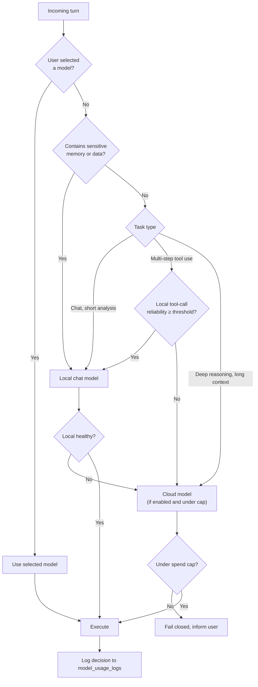

## 8. Backend Modules

### 8.1 Module List

| Module         | Responsibility                                              | Phase |
| -------------- | ----------------------------------------------------------- | ----- |
| `security`     | Authentication, authorisation, origin validation            | 0     |
| `common`       | Cross-cutting utilities only; no business logic             | 0     |
| `conversation` | Conversations, turns, `TurnOrchestrator` (6.5), streaming, cancellation | 1 |
| `ai`           | Provider ports, adapters, timeouts, fallback, usage, spend cap | 1  |
| `memory`       | Memory entries, sources, scopes, embeddings, search, export | 2     |
| `tools`        | MCP client integration, tool catalogue, definition pinning  | 2     |
| `approval`     | Policy evaluation, trifecta rule, approval requests         | 2     |
| `activity`     | Audit log of tool invocations, approvals and memory changes | 2     |
| `device`       | Device registry (host in Phase 2), connector authentication and routing (Phase 3) | 2–3 |
| `voice`        | Session tokens, voice session management                    | 5     |
| `agent`        | Agent profiles (prompt + allowed tools), orchestration      | 6     |
| `task`         | Reminders, scheduled and long-running jobs                  | 6     |

`personalization` from the original plan is folded into `memory` (preference entries) until it has distinct behaviour.

### 8.2 Package Structure

```text
<module>/
├── api/             REST controllers and DTOs
├── application/     Use cases and orchestration; transaction boundaries
├── domain/          Entities, value objects, business rules
└── infrastructure/  Drizzle repositories, external adapters
```

Dependency direction: `api → application → domain ← infrastructure`. Modules communicate only through `application`-layer interfaces. Enforced by `dependency-cruiser` rules in CI from Phase 0.

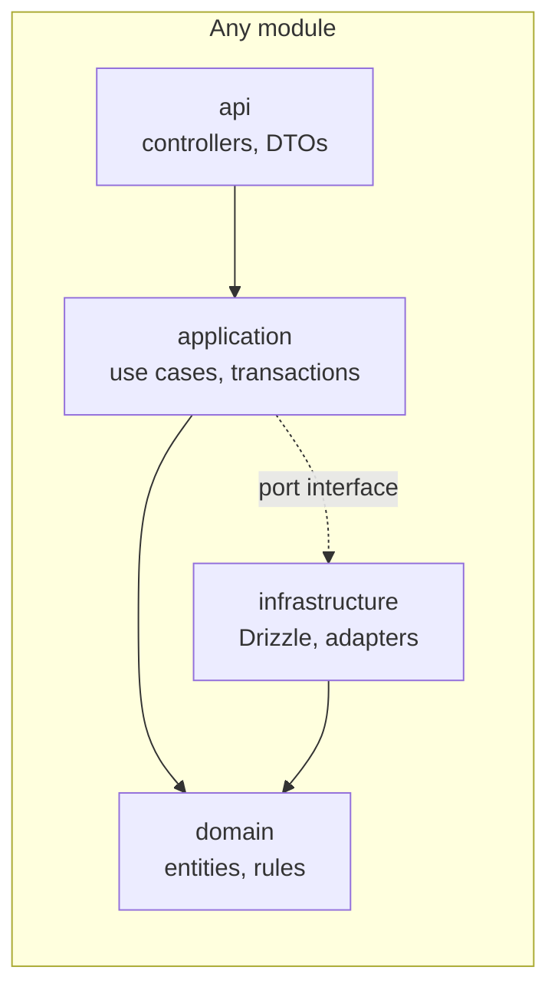

### 8.3 Module Dependencies (v0.1)

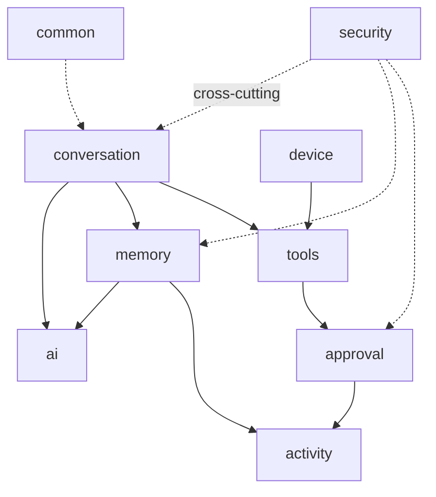

Cycles are forbidden and fail the architecture test.

## 9. Tools and Permission Model

### 9.1 Principle

The model **proposes**; the **Permission Engine decides**. Security never depends on the system prompt. Model output is untrusted input to the permission engine. Guardrail-style detection may be added but is never the only control.

### 9.2 Action Classes

| Class       | Examples                                     | Default policy                      |
| ----------- | -------------------------------------------- | ----------------------------------- |
| Read        | List files, read file, system status         | Automatic within granted scope      |
| Launch      | Open an application, open a URL              | Automatic if pre-approved, else ask |
| Write       | Create or modify a file                      | Ask, unless scope pre-approved      |
| Destructive | Delete, move outside scope, overwrite        | Explicit approval, every time       |
| External    | Send email/message, upload, HTTP to third party, open URL with data in it | Explicit approval, every time |
| Financial   | Purchase, payment                            | Explicit approval, every time       |

### 9.3 Trifecta Rule

Each conversation turn carries a **taint state**.

**Taint follows the provenance of content, not the permission to access it.** Being allowed to read a directory says nothing about whether a file in it is safe: a PDF in `Downloads` can carry a prompt injection, and even a file *name* returned by a directory listing is attacker-controllable. v0.4 treated results from a "trusted directory" as clean; v0.5 removes that exception.

| Content entering the context | Taints the turn? | Reason |
| --- | --- | --- |
| The user's own typed or spoken input | No | It is the principal's instruction |
| Confirmed memory entries written by the user | No | User-authored and confirmed |
| `system.status` (numbers produced by first-party code) | No | Fixed schema, no free text from outside |
| `filesystem.list` results | **Yes** | File and folder names are free text from any source |
| `filesystem.read` results, any directory | **Yes** | File contents are arbitrary third-party data |
| Web pages, emails, documents, imports | **Yes** | External content |
| Memory candidates or entries with `origin_tainted = true` | **Yes** | Inherit the taint of their origin |
| Any tool result with free-text fields | **Yes**, unless the tool is explicitly registered as `structured-only` | Default-deny for trust |

Rules:

- A tool may be registered as `structured-only` only if every output field is typed (numbers, enums, booleans, timestamps) and produced by first-party code. This is reviewed in the PR that adds the tool.
- In a tainted turn, any **External** or **Destructive** action is blocked outright in v0.x, and requires explicit approval with the taint source shown once those action classes exist.
- Memory writes proposed in a tainted turn are stored only as unconfirmed candidates.
- Taint is per turn and recorded on the turn and on every message it produced.

This removes the exfiltration leg of the lethal trifecta by construction rather than by detection.

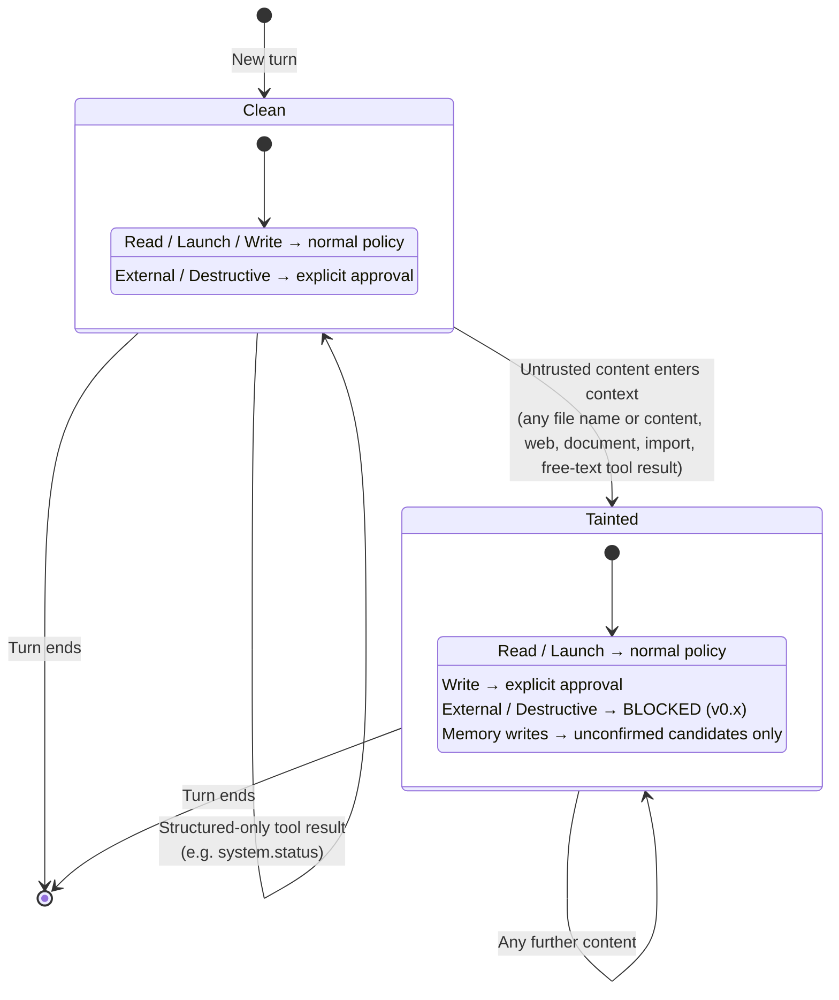

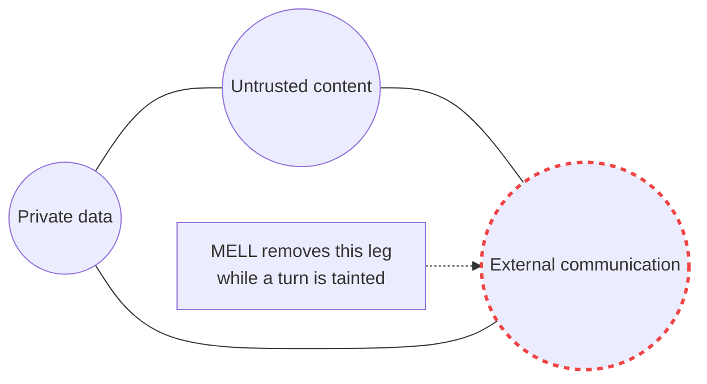

### 9.4 Approval Flow

1. Model emits a tool call.
2. The call is schema-validated (Section 7.4).
3. Permission Engine classifies it, checks scope (device, path, tool) and taint state.
4. If approval is required, an `approval_request` is created and pushed to the UI with the exact scope (e.g. the full file list for a delete).
5. Only an explicit approval executes the call; requests expire on timeout.
6. Every call, decision and result is written to `activity_logs`.

#### Approval binding (TOCTOU protection)

What the user approved must be exactly what runs. Between approval and execution the tool definition, the arguments or the target (for example the set of files matching a pattern) could change. Each approval is therefore bound to a fingerprint and re-verified immediately before execution:

| Bound field | Content |
| --- | --- |
| `approval_id` | Random, single-use; marked consumed atomically when execution starts |
| `tool_definition_hash` | Hash of the pinned definition (9.6) |
| `canonical_args_hash` | Hash of the canonicalised (sorted-key JSON) arguments |
| `resolved_scope` | The concrete targets shown to the user, e.g. absolute paths with size and modification time, or content hashes for files ≤ 10 MB |
| `device_id` | Target device |
| `turn_id`, `correlation_id` | Origin of the request |
| `expires_at` | Short window (default 5 minutes) |

At execution the device side recomputes the resolved scope and compares it with the bound value. Any mismatch — changed definition, different arguments, a file added, removed or modified — aborts the call, logs `approval.binding_mismatch` and asks the user again with the new scope. Approvals cannot be replayed, transferred to another device or widened.

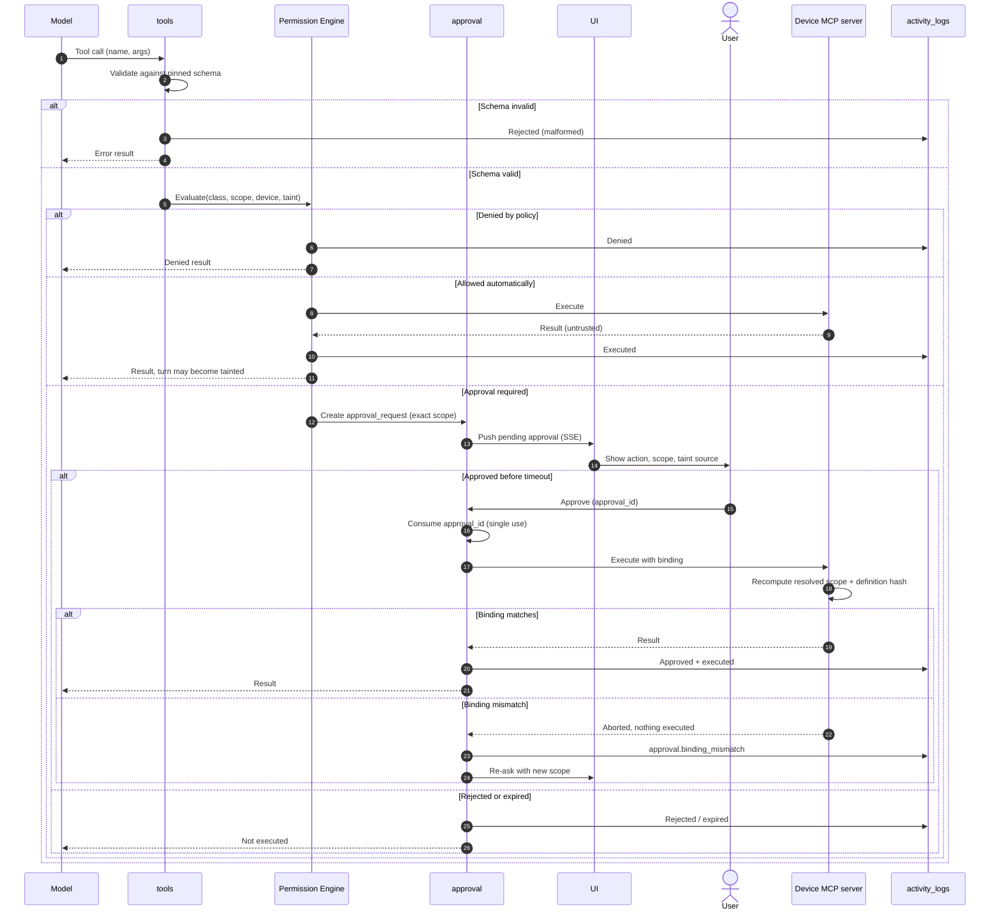

### 9.5 Untrusted Content

Text from web pages, documents, PDFs, emails, tool results or imports is data, never instructions. It cannot alter policies, grant permissions or trigger actions. It is passed to the model in clearly delimited blocks.

### 9.6 MCP Server Policy

1. Only first-party MCP servers, built in this repository, are allowed in v0.x.
2. On first connection, each tool's name, description and schema are shown to the user and approved; a hash of the definition is stored.
3. If a definition changes, the tool is disabled until re-approved (rug-pull protection).
4. Each server runs with the minimum OS privileges needed and only sees configured directories.
5. Third-party servers are considered only after a written security review per server (Phase 8).

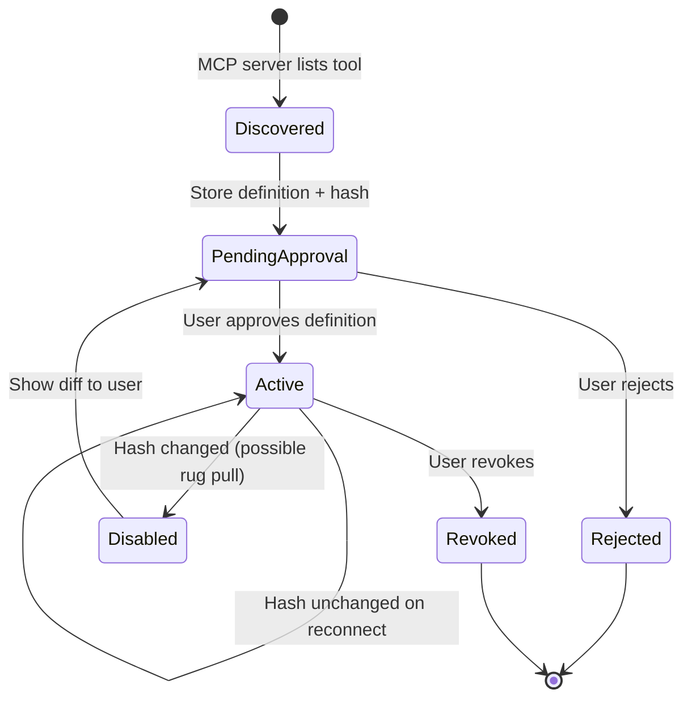

### 9.7 v0.1 Tools

- `filesystem.list`, `filesystem.read` — restricted to explicitly configured directories.
- `system.status` — CPU, memory, GPU utilisation.

Every read tool enforces limits per call — maximum bytes read, maximum entries listed and maximum directory depth — and marks a truncated result as truncated, so a large file or folder cannot flood the context or the model's budget.

## 10. Memory Design

### 10.1 Memory Types

| Type       | Example                                      | Phase |
| ---------- | -------------------------------------------- | ----- |
| Semantic   | "Uses Java 21 and Spring Boot at work"       | 2     |
| Preference | "Prefers short answers in Turkish"           | 2     |
| Project    | "MELL: personal assistant, modular monolith" | 2     |
| Episodic   | "Decided on pgvector on 2026-11-26"          | 4     |
| Procedural | "Release steps for project X"                | 4     |

Working memory (current conversation context) is handled by `conversation`, not persisted as memory.

### 10.2 Memory Scopes

To prevent context from unrelated areas of life spilling together, every entry belongs to a **scope**: `global`, or a named space (e.g. a project or "work"). Retrieval searches the conversation's active scope plus `global` only. Scopes are user-defined and visible in the Memory Center.

### 10.3 Write Policy

- **Phase 2:** memory is written only on explicit user instruction ("remember that…") or through the Memory Center. Every entry is confirmed.
- **Phase 4:** automatic extraction produces **candidates** only. Candidates are never used as confirmed facts and require user review.

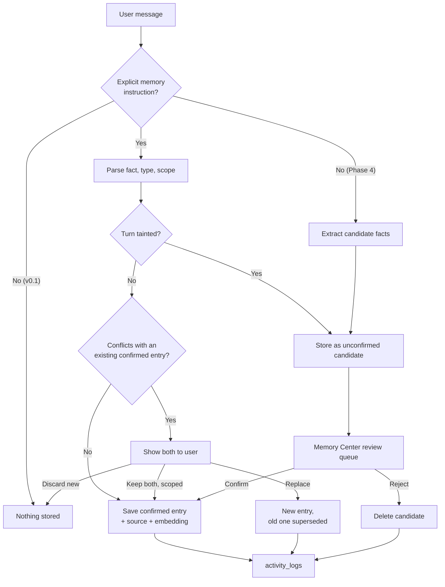

### 10.4 Integrity Rules

1. Every entry stores its source (conversation/message, import, manual).
2. Confirmed facts and model inferences are stored and presented separately.
3. No silent overwrite: an update creates a new entry and marks the previous one superseded, with a revision record.
4. Every create, update, supersede and delete is written to the activity log and visible to the user.
5. Entries carry validity (`valid_from`, `valid_until`); stale entries are not assumed current.
6. Deletion removes the entry, its embedding and any derived summaries.
7. The number of entries per scope and the storage used are visible; there is no hidden capacity limit.

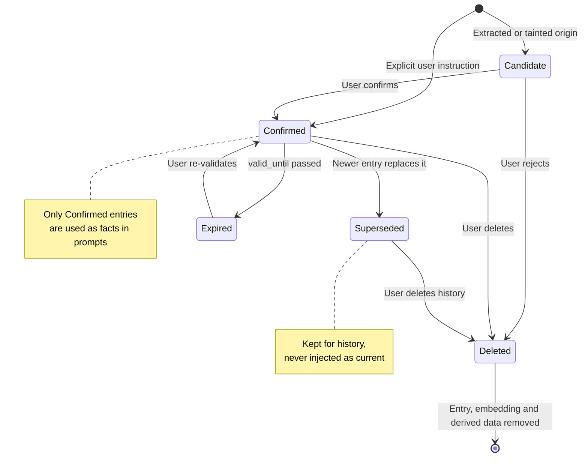

### 10.5 Export and Backup

- Full memory export to JSON and Markdown from the Memory Center at any time.
- Automated PostgreSQL backups from Phase 2; a restore is tested before Phase 3 begins.

### 10.6 Memory as a Security Boundary

Persistent memory can carry injected instructions from one session into all future sessions. Therefore:

- memory content is injected into prompts as data, in delimited blocks, never as system instructions;
- entries originating from tainted turns are never auto-confirmed;
- entries marked `sensitive` are never sent to cloud providers without per-request user consent.

### 10.7 Schema (Phase 2)

```text
memory_scopes
  id, user_id, name, created_at

memory_entries
  id, user_id, scope_id, memory_type, content,
  embedding vector(N),
  content_tsv tsvector GENERATED (to_tsvector('turkish', content)),
  confidence, sensitivity, is_confirmed, origin_tainted,
  valid_from, valid_until, superseded_by,
  created_at, updated_at

memory_sources
  id, memory_entry_id, source_type, source_ref, created_at
```

The embedding is a column on `memory_entries` so deletion is atomic. Changing the embedding model requires a re-embedding migration job; the model name and dimension are stored in configuration and checked at startup. Further tables (`memory_relations`, `memory_feedback`, `memory_access_logs`) are added only with the feature that needs them.

### 10.8 Import (Phase 7)

Pipeline: `upload → parse → preserve source → deduplicate → classify → extract candidates → conflict check → user review → persist`. Imported content is tainted by definition; nothing enters memory without review.

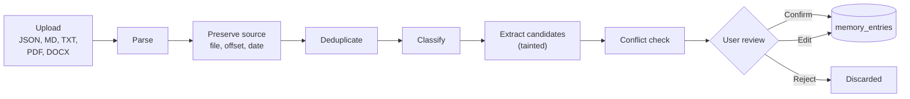

### 10.9 Retrieval

Pure vector search misses exact terms that matter in a personal assistant — project names, file names, version numbers, people's names — and Turkish morphology makes naive keyword search miss inflected forms. Retrieval is therefore **hybrid** from Phase 2:

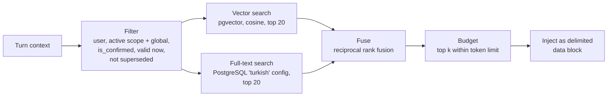

- **Metadata filters first**, in SQL, so no out-of-scope or unconfirmed entry can be retrieved regardless of similarity.
- **Two retrievers**: pgvector cosine similarity and PostgreSQL full-text search with the built-in `turkish` configuration (stemming) over a generated `tsvector` column.
- **Fusion**: reciprocal rank fusion (no score calibration needed between retrievers).
- **Budget**: a fixed token budget for memory in the prompt; entries are cut by rank, never truncated mid-entry.
- **Evaluation**: the recall test (14.3) compares vector-only, full-text-only and hybrid; hybrid is kept only if it is not worse than the best single retriever.
- Re-ranking with a cross-encoder is out of scope for v0.x.

## 11. Voice (Phase 5)

### 11.1 Approach

- Assembled from existing components; no custom hardware, no custom speech models. Default framework: LiveKit Agents (Node.js SDK, self-hosted LiveKit server) to stay in one language; Pipecat (Python-only) is the alternative if measurements favour it, run as an isolated service.
- Interaction order: **push-to-talk / global hotkey first**, continuous conversation second, wake word last.
- A Turkish wake word ("Mell" / "Hey Mell") is treated as a separate experiment, accepted only if it meets a false-activation target measured on real household audio. Short, common-sounding words are prone to false triggers; a longer phrase may be required.
- The backend issues short-lived client tokens; provider API keys never reach the client.
- Microphone state is always visible; listening can be disabled with one action.

### 11.2 Latency Budget

v0.4 set a 1.0 s target whose stage budgets summed to 1,050 ms before any network or orchestration overhead — the target could not be met by construction. v0.5 separates an **acceptance target** from a **stretch target** and makes the stage budgets add up:

| Stage | Acceptance budget (P50) | Stretch budget (P50) |
| --- | --- | --- |
| End-of-utterance detection | 250 ms | 200 ms |
| STT final transcript (after end of utterance) | 300 ms | 200 ms |
| MELL core: context build, retrieval, policy | 100 ms | 50 ms |
| LLM time-to-first-token | 400 ms | 300 ms |
| TTS time-to-first-audio | 150 ms | 100 ms |
| Transport, buffering, playback start | 100 ms | 50 ms |
| **Total, end of speech → first audio** | **1,300 ms** | **900 ms** |

- **Acceptance:** P50 ≤ 1.3 s and P95 ≤ 2.0 s on the Turkish voice evaluation set. Phase 5 exits on this.
- **Stretch:** P50 ≤ 0.9 s; pursued only after acceptance is met.
- Budgets are revised after the first measured baseline; the per-stage traces decide where time is actually spent.

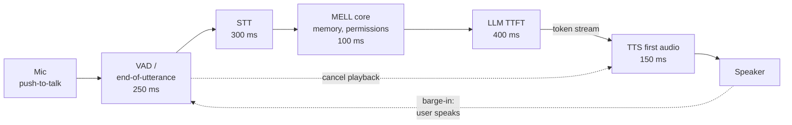

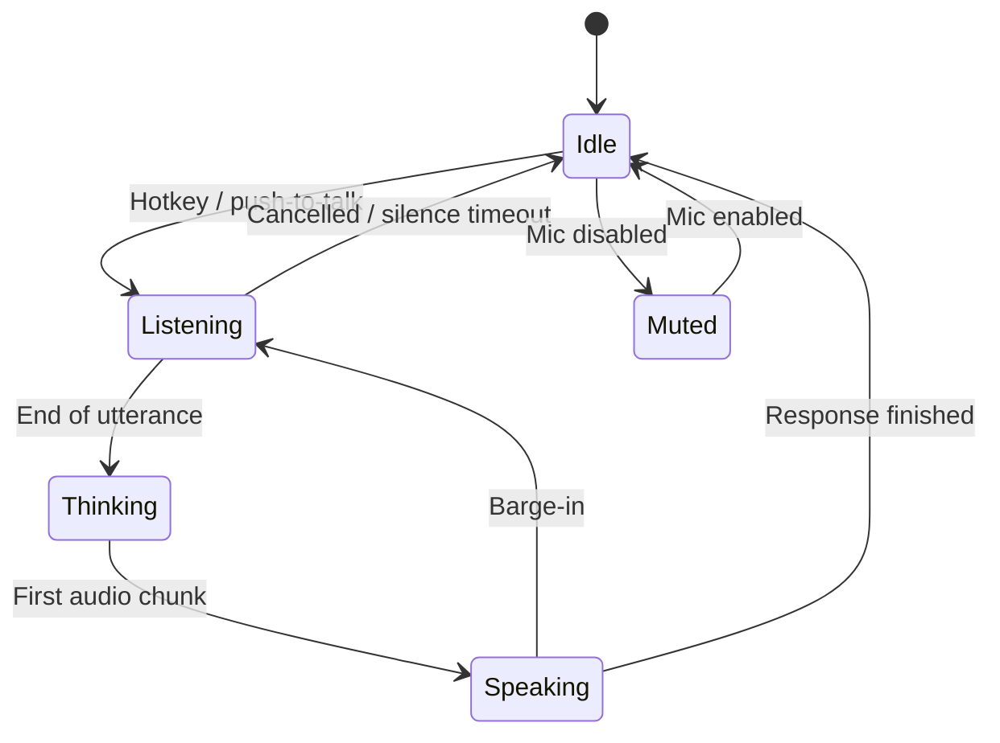

Each state has a distinct visual indicator in the UI; `Muted` is always reachable in one action.

Every voice turn is traced with one span per stage. Providers (cloud real-time, cascaded cloud, local) are selected by measured Turkish word error rate, latency and barge-in response time — not by voice quality alone. Decision recorded as an ADR; mode tracked as OD-2.

## 12. Security and Privacy

Threats, the mitigations below and the tests that verify them are tracked in [`security/threat-model.md`](security/threat-model.md).

1. **Network binding:** Ollama and PostgreSQL bind to `127.0.0.1` only. Device MCP servers open **no listening port** at all (stdio on the host, outbound connector on other devices, Section 6.3). The backend binds to loopback and, when cross-device access is enabled, to the private-network interface only. A startup self-check refuses to run if any service is bound to a public interface.
2. **Local endpoint authentication:** the backend requires authentication even on localhost, validates `Origin`/`Host` headers, and exposes no unauthenticated WebSocket or SSE endpoint. This prevents malicious web pages in the user's browser from driving the local agent.
3. **Private network:** cross-device traffic uses Tailscale or WireGuard; nothing is exposed publicly.
4. **Device identity:** each device has its own revocable credential and key; the device connector authenticates on every connection, and each device acts only within its granted scope and its own local allow-list.
5. **Secrets:** kept in environment variables or an OS secret store; never in frontend code, logs or the repository. Secret scanning runs in CI.
6. **Cloud data policy:** each cloud request is logged with provider, model and data classification; `sensitive` data is never sent without per-request consent. Remote/"cloud-routed" models offered through the local runtime are disabled.
7. **Spend cap:** configurable monthly cap per cloud provider; requests fail closed when exceeded; usage visible in the UI.
8. **Audit:** all tool invocations, approvals (with their binding), binding mismatches and memory changes are recorded with the turn's correlation id.
9. **Kill switches:** the user can disable listening, remote access, tools and cloud providers individually from the UI.
10. **Background tasks (Phase 6):** scheduled or proactive tasks run with a reduced permission set and can never perform External or Destructive actions without a live approval.
11. **Dependency hygiene:** Ollama, AI SDK and MCP SDK versions are pinned; all supply-chain controls in Section 6.8 apply.

## 13. Data Model and API (v0.1)

### 13.1 Tables

| Table               | Phase | Purpose |
| ------------------- | ----- | ------- |
| `users`             | 0     | Single user in v0.x; keys every other table |
| `conversations`     | 1     | Conversation metadata, selected model, active memory scope |
| `turns`             | 1     | One row per user input: correlation id, idempotency key, status, taint |
| `messages`          | 1     | User, assistant and tool messages of a turn |
| `ai_models`         | 1     | Registered models and runtime settings |
| `model_usage_logs`  | 1     | Tokens, latency and cost per model call |
| `memory_scopes`     | 2     | User-defined memory spaces |
| `memory_entries`    | 2     | Memory facts with embedding, full-text vector and lifecycle fields |
| `memory_sources`    | 2     | Provenance of each memory entry |
| `devices`           | 2     | Registered devices; the host is the first device |
| `tool_definitions`  | 2     | Pinned MCP tool definitions per device |
| `tool_permissions`  | 2     | Policy per tool: action class, allowed scope, auto-approve |
| `approval_requests` | 2     | Approvals with their binding (9.4) |
| `activity_logs`     | 2     | Append-only audit trail |

`devices` moves from Phase 3 to Phase 2 because the Windows host is itself a device with a pinned tool set. Other tables (`agents`, `agent_runs`, `tasks`, `scheduled_jobs`, etc.) are introduced with their phases. This table, the ER diagram and the schema in 10.7 are kept consistent; a change to one is a change to all three in the same PR.

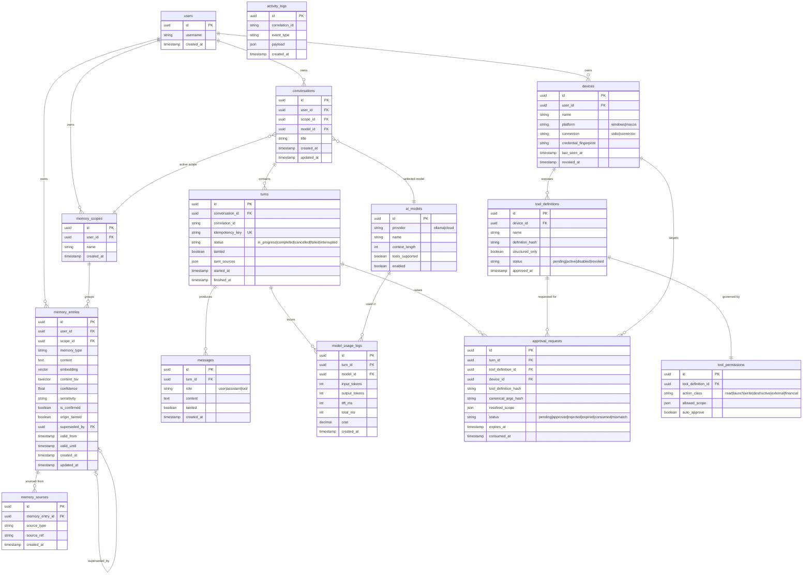

Column types are indicative; exact types, indexes and constraints are finalised in Drizzle migrations. `activity_logs` is append-only: the application role has no `UPDATE` or `DELETE` permission on it.

### 13.2 Endpoints

| Method | Path                                     | Phase |
| ------ | ---------------------------------------- | ----- |
| GET    | `/api/conversations`                     | 1     |
| POST   | `/api/conversations`                     | 1     |
| POST   | `/api/conversations/{id}/messages` (SSE) | 1     |
| GET    | `/api/ai/models`                         | 1     |
| GET    | `/api/ai/usage`                          | 1     |
| GET    | `/api/memories`                          | 2     |
| POST   | `/api/memories`                          | 2     |
| PATCH  | `/api/memories/{id}`                     | 2     |
| DELETE | `/api/memories/{id}`                     | 2     |
| GET    | `/api/memories/export`                   | 2     |
| GET    | `/api/tools`                             | 2     |
| POST   | `/api/tools/{id}/approve-definition`     | 2     |
| GET    | `/api/approvals/pending`                 | 2     |
| POST   | `/api/approvals/{id}/approve`            | 2     |
| POST   | `/api/approvals/{id}/reject`             | 2     |
| GET    | `/api/activity`                          | 2     |
| POST   | `/api/turns/{id}/cancel`                 | 1     |
| GET    | `/api/devices`                           | 2     |
| POST   | `/api/devices/pair`                      | 3     |
| DELETE | `/api/devices/{id}` (revoke)             | 3     |

All mutating endpoints accept `Idempotency-Key`; all endpoints accept and echo `X-Correlation-Id` (6.9).

Chat responses stream via SSE. WebSocket is introduced only when bidirectional real-time traffic is required (voice, device status).

## 14. Testing and Evaluation

### 14.1 Test Types

| Test type          | Scope                                                         | From phase |
| ------------------ | ------------------------------------------------------------- | ---------- |
| Unit               | Domain rules                                                  | 0          |
| Architecture       | Module boundaries                                             | 0          |
| Integration        | PostgreSQL via Testcontainers (Node); model runtime via contract stub | 1         |
| API                | Endpoints, authentication, origin checks                      | 1          |
| Model evaluation   | Fixed Turkish prompt set per model; quality, TTFT, tokens/s   | 1          |
| Tool-call contract | Valid/invalid/multi-step tool calls per model and runtime version | 2      |
| Security           | Prompt-injection corpus, content-based taint (file names and contents), tool-definition change, approval binding mismatch and replay, unauthenticated local requests | 2 |
| Reliability        | Idempotent replay, cancellation mid-stream and mid-tool, interrupted turns after restart | 1 |
| Memory evaluation  | Recall, update, correction, deletion, scope isolation         | 2          |
| Recovery           | Network loss, host offline, model unavailable                 | 3          |
| Voice              | Per-stage latency, Turkish WER, barge-in, false wake rate     | 5          |

### 14.2 Memory Evaluation Set

Versioned scenarios in `eval/memory/`, run on every change to the memory module:

- Is a stored fact recalled correctly in a new conversation?
- After an update, are old and new facts kept distinct?
- Is an unconfirmed inference ever presented as fact?
- After a correction, does the old fact reappear?
- After deletion, is the entry absent from vector search?
- Does a fact from scope A leak into a conversation in scope B?
- Does an instruction stored as memory content ever get executed as an instruction?

Public benchmarks (e.g. LongMemEval, LoCoMo) may be used for reference, but acceptance is decided by this set.

### 14.3 Embedding Recall Test

A Turkish query/fact set (morphological variants, synonyms, English–Turkish code-switching typical of technical speech) compares embedding candidates on recall@5. The result and the chosen model are recorded as an ADR.

### 14.4 Acceptance Thresholds (initial, revisable)

| Metric                                         | Threshold |
| ---------------------------------------------- | --------- |
| Memory recall@5 on evaluation set              | ≥ 0.90    |
| Deleted-entry leakage                          | 0         |
| Cross-scope leakage                            | 0         |
| Valid tool calls on contract suite (local)     | ≥ 0.95, else fallback per Sec. 7.4 |
| Prompt-injection corpus: blocked External/Destructive actions | 100% |
| Approval executed after binding mismatch or replay | 0 |
| Duplicate execution on repeated `Idempotency-Key` | 0 |
| Chat TTFT P50 (local, short prompt)            | Measured and recorded in Phase 1; target set from baseline |

## 15. Delivery Phases

Each phase ends with a working, demonstrable system. Phases define scope, not dates.

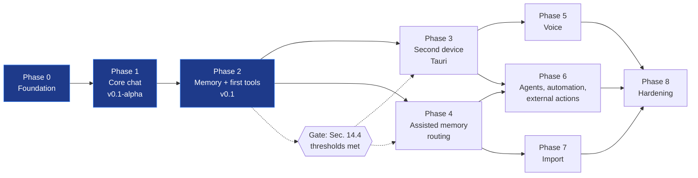

Phases 0–2 (highlighted) make up v0.1. No phase after Phase 2 starts until the Phase 2 gate is passed.

### Phase 0 — Foundation

- Repository, README, this plan, ADR template.
- pnpm workspace; NestJS backend skeleton with module structure and `dependency-cruiser` rules.
- PostgreSQL + pgvector via Docker Compose; Drizzle baseline migration.
- Local single-user authentication (session cookie, CSRF protection) and origin validation.
- Network-binding startup self-check.
- Health endpoint; CI with typecheck, lint, tests, dependency audit and secret scanning; supply-chain settings from Section 6.8.

**Exit:** `docker compose up` and backend start cleanly; health returns `UP`; unauthenticated request is rejected; architecture tests pass in CI.

### Phase 1 — Core Chat (v0.1-alpha)

- `conversation` and `ai` modules; Ollama adapter and one cloud adapter behind the ports.
- SSE streaming, history, manual model selection.
- System prompt and persona versioned in the repository.
- Minimal Svelte chat screen on localhost, using the streaming-rendering rules in 16.0.
- Model usage logging and spend cap.
- Model evaluation baseline recorded.

**Exit:** a Turkish conversation streams end-to-end; history persists across restarts; switching to the cloud model requires no code change; a turn can be cancelled mid-stream; a repeated request with the same `Idempotency-Key` does not create a second turn; baseline TTFT and quality recorded.

### Phase 2 — Memory and First Tools (v0.1)

- Embedding recall test and ADR; pgvector; memory CRUD, scopes, semantic search, export.
- Explicit "remember / forget" handling in chat.
- Memory Center screen.
- First-party Windows MCP server (`filesystem.list`, `filesystem.read`, `system.status`); definition pinning.
- Permission Engine with trifecta rule; approval requests; Activity screen.
- Tool-call contract and security test suites.
- Backup job.

**Exit:** memory and security thresholds in Section 14.4 are met; a file read outside scope is blocked and logged; reading any file taints the turn; a modified tool definition disables the tool; an approval whose target changed after approval is not executed.

### Phase 3 — Second Device and Desktop Shell

- Tauri 2 packaging for Windows and macOS.
- Private network; device registry and authentication.
- First-party Mac MCP server; routing by target device.
- Host-offline handling in the client; tested restore from backup.

**Exit:** from the Mac, the user can chat and run an allowed tool on both machines; the Mac opens no listening port (verified with a port scan); a revoked device cannot reconnect; an offline host produces a clear status.

### Phase 4 — Assisted Memory and Routing

- Automatic candidate extraction with review queue; episodic and procedural memory.
- Rule-based routing; optional additional local models after benchmarking.
- Write-class tools with approval.

**Exit:** candidates never used before confirmation; routing decisions logged and overridable; memory thresholds still met.

### Phase 5 — Voice

- Provider evaluation and ADR; push-to-talk; streaming STT/TTS; barge-in; per-stage tracing.
- Wake-word experiment as a separate, optional step.

**Exit:** acceptance latency targets in Section 11.2 met (P50 ≤ 1.3 s, P95 ≤ 2.0 s) on the Turkish voice set.

### Phase 6 — Agents, Automation and External Actions

- Agent profiles (prompt + allowed tool set); orchestrator only if a single agent proves insufficient.
- Reminders, scheduled jobs, retries, notifications under reduced permissions.
- First External-class tools, gated by the trifecta rule and per-action approval.

### Phase 7 — Import

- ChatGPT export, JSON, Markdown, TXT, PDF, DOCX through the reviewed pipeline (Section 10.8).

### Phase 8 — Hardening

- Monitoring and error reporting; installers; backup/restore drills; external security review; per-server review process for any third-party MCP server; optional VPS.

## 16. UI Sketches (v0.1)

### 16.0 Streaming Rendering Rules

The common performance failure in LLM chat UIs is re-parsing and re-rendering the whole accumulated Markdown on every token, which makes long answers and long conversations progressively slower. This is a rendering-architecture problem independent of the framework, so it is fixed by rules:

1. **Block-level incremental rendering.** The streaming message is split into Markdown blocks; completed blocks are rendered once and never re-parsed; only the last, open block is updated per token.
2. **Batch updates per animation frame.** Tokens arriving within one frame are applied together.
3. **Window long conversations.** Only messages near the viewport are rendered; older ones are virtualised.
4. **Sanitise rendered HTML** with DOMPurify before insertion; model output is untrusted (9.5).
5. **Defer heavy blocks.** Syntax highlighting and diagrams render after their block closes.
6. **Measure.** Frame time and input latency during a 2,000-token answer are part of the Phase 1 baseline.

**Design direction: a voice-first command center, not a chat app.** The primary view (16.6) centres on a voice core and surrounds it with live system state, memory in context, activity and safeguards, so the user always sees what MELL knows, what it is doing and what it is allowed to do. Visual language: near-black background, cyan and blue accents, thin HUD-style panel frames, monospace telemetry, restrained motion that reflects real state (listening, thinking, speaking) rather than decoration. The design is original; no third-party characters, logos or film interfaces are reproduced.

The wireframes in 16.1–16.5 fix information content for the secondary views; the visual reference for the primary view is the concept in 16.6.

### 16.1 Navigation

```mermaid
flowchart LR
    SHELL["App shell"] --> CHAT["Chat"]
    SHELL --> MEMC["Memory Center"]
    SHELL --> ACT["Activity"]
    SHELL --> SET["Settings"]
    SET --> MODELS["Models and cloud cap"]
    SET --> TOOLS["Tools and definitions"]
    SET --> PRIV["Privacy and kill switches"]
    CC["Command Center<br/>(primary view)"] --> CHAT
    SHELL --> CC
    CC -.->|"pending approval"| APPR
    CHAT -.->|"pending approval"| APPR["Approval dialog"]
```

### 16.2 Chat

```text
┌──────────────────────────────────────────────────────────────────────┐
│ MELL                         Model: [qwen3:8b · local ▾]  Scope: [MELL ▾] │
├────────────┬─────────────────────────────────────────────────────────┤
│ Chats      │                                                         │
│ ─────────  │  You: MELL, yeni projelerimde Java 21 kullanıyorum,     │
│ > MELL plan│       bunu hatırla.                                     │
│   Wick API │                                                         │
│   Notes    │  MELL: Kaydettim: "Prefers Java 21 for new projects"     │
│            │        [Memory · confirmed · scope: global]  [Undo]     │
│            │                                                         │
│ ─────────  │  You: Downloads klasöründeki son PDF'i bul.             │
│ Chat       │                                                         │
│ Memory     │  MELL: ⚙ filesystem.list  (Downloads) · auto · 0.2 s    │
│ Activity   │        Son PDF: invoice-2026-11.pdf (24 Kas)            │
│ Settings   │                                                         │
│            ├─────────────────────────────────────────────────────────┤
│ ● Local OK │  [ Mesaj yaz…                                  ] [Send] │
│ ○ Cloud off│  Tokens: 1.2k · TTFT 0.41 s · Cloud spend: $0.00 / $10  │
└────────────┴─────────────────────────────────────────────────────────┘
```

Every memory write and tool call is shown inline with its status, so nothing happens invisibly.

### 16.3 Memory Center

```text
┌──────────────────────────────────────────────────────────────────────┐
│ Memory Center                      [Search…        ]  [Export ▾] [+ Add] │
├──────────────┬───────────────────────────────────────────────────────┤
│ Scopes       │ Confirmed (42)   Candidates (3)   Superseded (5)      │
│ ──────────   │ ───────────────────────────────────────────────────── │
│ ● global  18 │ Prefers Java 21 for new projects                     │
│ ○ MELL    12 │ semantic · global · source: chat 2026-11-26 · ✓       │
│ ○ Wick     7 │                                   [Edit] [Delete]     │
│ ○ work     5 │ ───────────────────────────────────────────────────── │
│              │ MELL uses a TypeScript modular monolith               │
│ Storage      │ project · MELL · source: chat 2026-11-26 · ✓          │
│ 42 entries   │                                   [Edit] [Delete]     │
│ 1.1 MB       │ ───────────────────────────────────────────────────── │
│              │ ⚠ Candidate: "Works late on weekdays"                 │
│ Embedding    │ preference · inferred · origin: tainted (web page)    │
│ bge-m3 1024d │                          [Confirm] [Edit] [Reject]    │
└──────────────┴───────────────────────────────────────────────────────┘
```

### 16.4 Approval Dialog

```text
┌──────────────────────────────────────────────────────────┐
│ ⚠  Approval required                         expires 4:58 │
├──────────────────────────────────────────────────────────┤
│ Action    filesystem.delete            class: Destructive │
│ Device    Windows host                                    │
│ Scope     3 files in C:\Users\<user>\Downloads\tmp        │
│           • report-old.pdf     (2.1 MB)                   │
│           • report-old (1).pdf (2.1 MB)                   │
│           • notes.tmp          (4 KB)                     │
│ Taint     Clean · targets selected by the user in the UI  │
│ Requested by model: qwen3:8b · conversation "Cleanup"     │
├──────────────────────────────────────────────────────────┤
│              [ Reject ]              [ Approve once ]     │
└──────────────────────────────────────────────────────────┘
```

If the turn is tainted, External and Destructive actions do not reach this dialog in v0.x; the UI shows a "blocked by policy" entry with the taint source instead.

### 16.5 Activity

```text
┌──────────────────────────────────────────────────────────────────────┐
│ Activity                 Filter: [All ▾] [Device ▾] [Last 24 h ▾]      │
├───────────┬──────────────┬───────────────────────────┬───────────────┤
│ Time      │ Type         │ Detail                    │ Decision      │
├───────────┼──────────────┼───────────────────────────┼───────────────┤
│ 12:41:07  │ tool.call    │ filesystem.list Downloads │ auto · ok     │
│ 12:40:55  │ memory.add   │ "Prefers Java 21…"        │ user · ok     │
│ 12:38:12  │ tool.call    │ filesystem.read C:\Win…   │ denied: scope │
│ 12:30:02  │ tool.def     │ system.status hash changed│ disabled      │
│ 12:12:44  │ cloud.req    │ provider X · 2.3k tokens  │ under cap     │
└───────────┴──────────────┴───────────────────────────┴───────────────┘
```

### 16.6 Command Center (primary view)

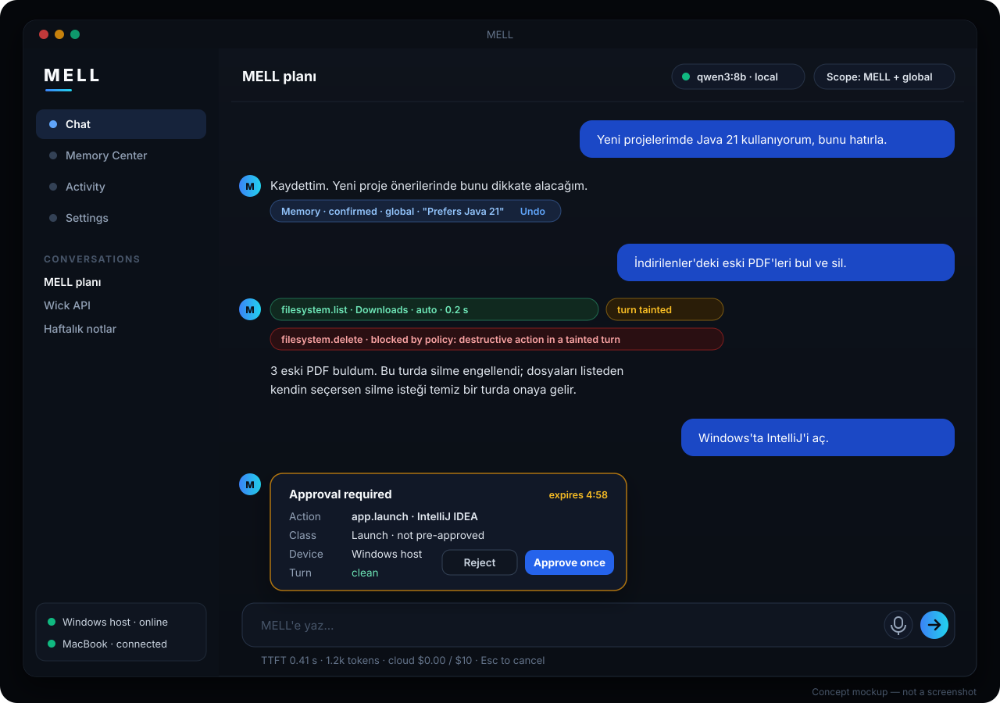

| Region | Content | Source of truth |
| --- | --- | --- |
| Voice core (centre) | State ring (idle, listening, thinking, speaking, muted), live waveform, current turn id, live transcript and spoken reply | Voice session and turn state (11, 6.5) |
| System (left) | VRAM, CPU, RAM, resident models, TTFT | Host telemetry, `model_usage_logs` |
| Devices (left) | Host and connected devices, transport, latency, cloud status and spend | `devices`, connector heartbeats, spend cap |
| Safeguards (left) | Current turn taint, policy summary, kill switches for microphone, tools, remote access and cloud | Permission Engine, settings (9.3, 12.9) |
| Memory in context (right) | Entries injected into the current turn, with scope, confirmation and source | Retrieval result of stage 2 (10.9) |
| Activity (right) | Live, correlation-linked stream of tool calls, taint changes, policy decisions, memory changes, approvals | `activity_logs` |
| Authorization (centre bottom) | Pending approval with action, target, taint, binding fingerprint, countdown | `approval_requests` (9.4) |
| Command bar (bottom) | Text input, push-to-talk, shortcuts (hold Space, Esc to cancel, mute, command palette) | — |

Rules:

- Every value on screen comes from real state; no decorative or simulated telemetry.
- Animation reflects state changes only and respects the OS "reduce motion" setting.
- The text chat (16.2) remains available as a secondary view and for long answers; both views share the same turn.
- Panels can be collapsed; the voice core and the authorization card are never hidden while an approval is pending.

## 17. Risks

| ID   | Risk | Impact | Mitigation |
| ---- | ---- | ------ | ---------- |
| R-1  | Scope exceeds available time; project stalls | High | Narrow v0.1; each phase independently useful; strict non-goals |
| R-2  | Prompt injection leads to data exfiltration or unwanted actions | High | Trifecta rule; policy outside the model; no external tools before Phase 6; audit |
| R-3  | Malicious or modified tool definitions (tool poisoning, rug pull) | High | First-party servers only; definition pinning; visible descriptions |
| R-4  | Local services exposed to network or hijacked by local web pages | High | Loopback binding with self-check; authentication and origin checks on localhost |
| R-5  | Memory stores, alters or loses facts silently | High | Explicit-only writes in v0.1; no silent overwrite; audit; export; backups; evaluation set |
| R-6  | Local model tool calling unreliable | Medium | Schema validation; contract tests; pinned runtime; cloud or runtime fallback |
| R-7  | Turkish quality of embeddings or models insufficient | Medium | Turkish evaluation sets; multiple candidates; Turkish-adapted encoders |
| R-8  | VRAM contention and model swap latency | Medium | One resident chat model; explicit Ollama scheduling config; benchmarks |
| R-9  | Host offline makes the secondary client unusable | Medium | Clear offline state; OD-1 decides VPS timing |
| R-10 | Voice latency or wake-word false triggers make voice unusable | Medium | Push-to-talk first; measured budget; wake word optional |
| R-11 | Uncontrolled cloud cost | Low | Spend cap; usage visibility |
| R-12 | Coupling to AI SDK or a specific provider | Medium | Internal ports; adapters isolated in `infrastructure`; pinned versions |
| R-13 | Compromised npm dependency (supply-chain worm) | High | Section 6.8 controls; minimal dependencies; no install scripts; release-age delay; audit in CI |
| R-14 | Developer less experienced in Node backend than in Java | Medium | NestJS mirrors Spring concepts; strict TypeScript; small scope; tests first |
| R-15 | Approved action differs from executed action (TOCTOU) | High | Approval binding and re-verification at execution (9.4) |
| R-16 | Injected instructions via file names or contents in an allowed directory | High | Content-based taint (9.3); no trusted-directory exception |

## 18. Open Decisions

| ID   | Question | Needed by |
| ---- | -------- | --------- |
| OD-1 | How reliably will the Windows host be online? Determines VPS timing. | Phase 3 |
| OD-2 | Voice mode: cloud real-time, cascaded cloud, or local — decided by measurement. | Phase 5 |
| OD-3 | Host the Mac device connector inside the Tauri app, or as a standalone background process. | Phase 3 |
| OD-4 | Initial cloud provider and model. | Phase 1 |
| OD-5 | ~~Frontend framework~~ — **closed**: Svelte 5 (6.7.1, ADR 0011). | — |
| OD-6 | Final embedding model, from the recall test (Sec. 14.3). | Phase 2 |
| OD-7 | Reuse an existing chat front end (e.g. Open WebUI) during early phases, or keep a minimal custom UI from the start. | Phase 1 |

## 19. Engineering Rules

MELL follows **[agent-playbook](https://github.com/eerenyilmazz/agent-playbook)** for company-wide engineering, security, git, documentation and review rules. They are not restated here; the playbook is the single source. The project's playbook selection and overrides are declared in the repository `README.md` (*Playbook* section), as the playbook requires.

| Playbook element | MELL selection |
| --- | --- |
| Templates | `software`, `desktop`, `web` |
| Roles | `backend`, `frontend`, `qa-security`, `security-reviewer`, `code-reviewer`, `decision-maker`, `technical-writer`, `devops-cloud` |
| Precedence | User's explicit instruction → README overrides → playbook `company/` → templates → roles → skills |
| ADR format | `templates/software/architecture-decision-record.md`; files in `docs/adr/` |

MELL-specific rules that the playbook does not cover:

1. Business logic never depends directly on an AI provider, runtime or AI SDK types; changing the model or runtime must not require changes outside the `ai` module.
2. Security checks are never delegated to the model prompt.
3. Model output, tool results, file names and contents, and retrieved memory are untrusted input everywhere in the code (9.3, 9.5).
4. Every new tool declares its action class and whether it is `structured-only`; both are reviewed in the PR that adds it.
5. TypeScript `strict` everywhere; no `any` in domain code; all external input validated with Zod at the boundary.
6. Every turn-level operation carries the correlation id (6.9).
7. The data model is changed in three places at once: the table list and ER diagram (13.1), the schema notes (10.7) and the migration.
8. Supply-chain controls in Section 6.8 are mandatory, not advisory.

## 20. Repository Layout

```text
mell-assistant/
├── apps/
│   ├── backend/               NestJS modular monolith
│   ├── ui/                    Svelte 5 + SvelteKit static + Vite (+ src-tauri from Phase 3)
│   └── mcp-device/            first-party device MCP server (one codebase,
│                              platform adapters for Windows and macOS)
├── packages/
│   └── contracts/             Zod schemas and DTO types shared by backend and UI
├── infrastructure/
│   └── docker-compose.yml
├── eval/
│   ├── memory/
│   ├── models/
│   ├── tool-calls/
│   └── security/              prompt-injection corpus
├── docs/
│   ├── PLAN.md                this document
│   ├── adr/                   decision records (playbook ADR format)
│   ├── security/              threat model
│   └── benchmarks/
├── scripts/
├── AGENTS.md                  instructions for coding agents
├── .npmrc                     supply-chain settings (Sec. 6.8)
├── pnpm-workspace.yaml
├── .gitignore
└── README.md
```

Further design documents (memory, voice, security, API) are written when their phase begins.

## 21. Initial ADRs

Recorded in `docs/adr/` using the playbook ADR format. Accepted ADRs are immutable; changes are made by superseding.

| ADR | Title |
| --- | --- |
| [0001](adr/0001-typescript-end-to-end-nestjs-monolith.md) | TypeScript end-to-end; modular monolith on NestJS |
| [0002](adr/0002-postgresql-pgvector-single-store.md) | PostgreSQL with pgvector as the single data store |
| [0003](adr/0003-first-party-mcp-servers.md) | First-party MCP servers for tool and device integration |
| [0004](adr/0004-permission-engine-and-content-based-taint.md) | Permission enforcement outside the model; content-based taint |
| [0005](adr/0005-explicit-scoped-memory-writes.md) | Explicit-only memory writes in v0.1; scoped memory |
| [0006](adr/0006-manual-model-selection-first.md) | Manual model selection before automatic routing |
| [0007](adr/0007-defer-redis-tauri-voice-external-actions.md) | Defer Redis, Tauri, voice and external actions beyond v0.1 |
| [0008](adr/0008-authenticated-localhost-loopback-services.md) | Authenticated localhost backend and loopback-only services |
| [0009](adr/0009-device-connectivity-without-listening-ports.md) | Device connectivity without listening ports |
| [0010](adr/0010-bind-approvals-to-verified-fingerprint.md) | Bind approvals to a verified fingerprint |
| [0011](adr/0011-svelte-5-frontend.md) | Svelte 5 for the frontend |

## Appendix A. References

- Simon Willison — *The lethal trifecta for AI agents* — <https://simonwillison.net/2025/Jun/16/the-lethal-trifecta/>
- Palo Alto Networks — *OpenClaw (formerly Moltbot, Clawdbot) May Signal the Next AI Security Crisis* — <https://www.paloaltonetworks.com/blog/network-security/why-moltbot-may-signal-ai-crisis/>
- The Register — *OpenClaw security problems* — <https://www.theregister.com/2026/02/03/openclaw_security_problems/>
- Security Boulevard — *OpenClaw flaw lets malicious websites hijack local AI agents* — <https://securityboulevard.com/2026/03/latest-openclaw-flaw-can-let-malicious-websites-hijack-local-ai-agents/>
- TechRadar — *OpenClaw security risks* — <https://www.techradar.com/pro/here-are-the-openclaw-security-risks-you-should-know-about>
- Huang et al. — *MCP Threat Modeling and Tool Poisoning* (arXiv 2603.22489) — <https://arxiv.org/html/2603.22489v1>
- Elastic Security Labs — *MCP Tools: Attack Vectors and Defense Recommendations* — <https://www.elastic.co/security-labs/mcp-tools-attack-defense-recommendations>
- Cisco Talos — *Detecting exposed LLM servers: Ollama* — <https://blogs.cisco.com/security/detecting-exposed-llm-servers-shodan-case-study-on-ollama>
- SANS — *Your local AI server is not local* — <https://www.sans.org/blog/your-local-ai-server-is-not-local-finding-exposed-ollama-hosts-without-crossing-line>
- Rapid7 — *Self-hosted AI: exposed servers* — <https://rapid7.com/blog/post/tr-self-hosted-ai-renting-compute-exposed-servers>
- Ollama — *Tool calling documentation* — <https://docs.ollama.com/capabilities/tool-calling>
- Ollama issue #14493 — Qwen tool-calling format mismatch — <https://github.com/ollama/ollama/issues/14493>
- Strix issue #520 — qwen3:8b tool calls returned as text — <https://github.com/usestrix/strix/issues/520>
- Ollama scheduling (keep-alive, max loaded models) — <https://mljourney.com/ollama-keep-alive-and-model-preloading-eliminate-cold-start-latency/>
- Vercel AI SDK — *What's new in AI SDK 7* — <https://www.developersdigest.tech/blog/vercel-ai-sdk-whats-new-2026>
- AI SDK — *MCP tools* — <https://app.unpkg.com/ai@7.0.173/files/docs/03-ai-sdk-core/16-mcp-tools.mdx>
- ai-sdk-ollama provider — <https://app.unpkg.com/ai-sdk-ollama@4.2.0/files/README.md>
- MCP blog — *2026-07-28 specification* — <https://blog.modelcontextprotocol.io/posts/2026-07-28/>
- Official MCP SDKs and tiers — <https://eseospace.com/blog/mcp-official-sdks/>
- LiveKit Agents vs Pipecat — <https://agentpedia.codes/blog/livekit-agents-vs-pipecat>
- Tauri — *Node.js as a sidecar* — <https://v2.tauri.app/learn/sidecar-nodejs/>
- Unit 42 — *Monitoring npm supply chain attacks* — <https://unit42.paloaltonetworks.com/monitoring-npm-supply-chain-attacks/>
- Akamai — *Mini Shai-Hulud worm returns* — <https://www.akamai.com/blog/security-research/mini-shai-hulud-worm-returns-goes-public>
- Letta — *Benchmarking AI agent memory* — <https://www.letta.com/blog/benchmarking-ai-agent-memory>
- Mem0 vs Letta comparison — <https://ryanalberts.github.io/best-of-Agent-Harnesses/compare/memory-layers/>
- Tom's Guide — *ChatGPT memories disappearing* — <https://www.tomsguide.com/ai/chatgpt/chatgpt-memories-are-disappearing-for-some-users-heres-how-to-protect-yours>
- Axios — *ChatGPT memory update* — <https://www.axios.com/2025/07/11/chatgpt-memory-update>
- The Register — *Mycroft AI killed off* — <https://www.theregister.com/2023/02/13/linux_ai_assistant_killed_off/>
- OpenVoiceOS Foundation — <https://www.cnx-software.com/2025/02/24/the-openvoiceos-foundation-aims-to-enable-open-source-privacy-and-customization-for-voice-assistants/>
- Home Assistant — *About wake words* — <https://home-assistant.io/voice_control/about_wake_word>
- Picovoice — *Multilingual voice user interfaces* — <https://picovoice.ai/blog/multilingual-voice-user-interfaces>
- Twilio — *Core latency in AI voice agents* — <https://www.twilio.com/en-us/blog/developers/best-practices/guide-core-latency-ai-voice-agents>
- ElevenLabs — *Voice agent latency optimization* — <https://elevenlabs.io/blog/voice-agent-latency-optimization>
- TR-MTEB (EMNLP Findings 2025) — <https://preview.aclanthology.org/author-page-yu-wang-polytechnic/2025.findings-emnlp.471.pdf>
- TurkColBERT (arXiv 2511.16528) — <https://arxiv.org/html/2511.16528v1>
- TurkEmbed (arXiv 2511.08376) — <https://arxiv.org/pdf/2511.08376>
- Open WebUI — *Open WebUI & LibreChat* — <https://docs.openwebui.com/alternatives/librechat>
- PostgreSQL — *Text search: psql support (built-in snowball stemmers incl. `turkish_stem`)* — <https://www.postgresql.org/docs/18/textsearch-psql.html>
- agent-playbook — project rule library this repository follows — <https://github.com/eerenyilmazz/agent-playbook>
- AI SDK — *AI SDK UI overview (framework support: React, Svelte, Vue, Angular; SolidJS community)* — <https://ai-sdk.dev/docs/ai-sdk-ui/overview>
- js-framework-benchmark — live results — <https://krausest.github.io/js-framework-benchmark/>
- Chrome for Developers — *Best practices to render streamed LLM responses* — <https://developer.chrome.com/docs/ai/render-llm-responses>
- AI SDK — *Markdown chatbot with memoization* — <https://ai-sdk.dev/resources/recipes/next/markdown-chatbot-with-memoization>
